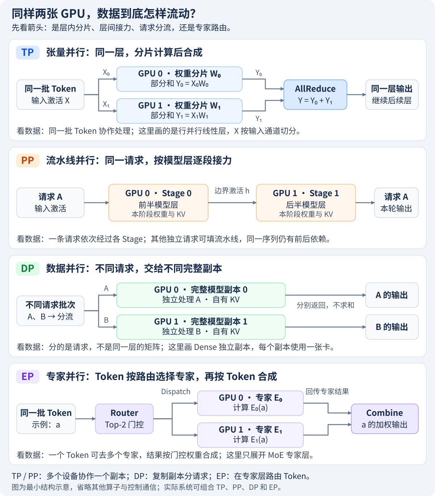
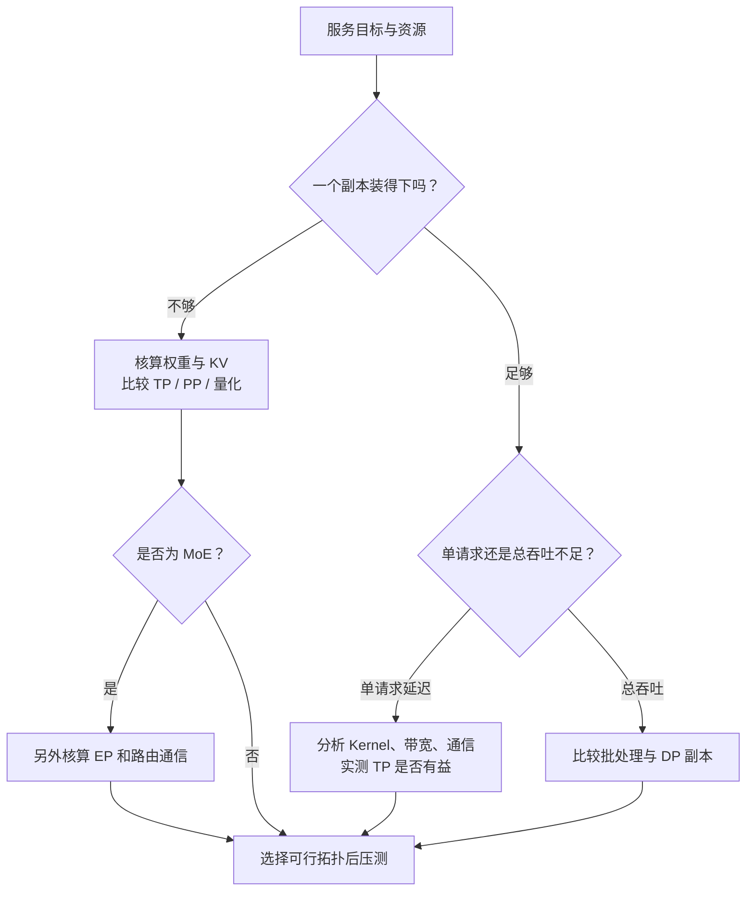

一个人搬不动的大柜子，需要几个人一起抬；订单太多忙不过来的餐厅，则可以再开一家分店。两者都增加了人手，解决的问题却不同。**模型单卡装不下，要把一次前向拆开；单份引擎已能服务但吞吐不足，要考虑增加副本。** 先分清这两个问题，再谈用了几张卡。

前面介绍的量化和投机解码改变数据表示或生成流程；这一章把镜头拉到设备之间，看看模型、请求和通信怎样组织。本章部署接口以 **vLLM v0.19.0** 的文档与源码为基准，升级时应重新核对支持范围。

<!-- more -->

## 📑 目录

- [1. 推理并行与训练并行，目标有什么不同](#1-推理并行与训练并行目标有什么不同)
- [2. 四种并行，各自切的是什么](#2-四种并行各自切的是什么)
- [3. 显存账本：切权重不等于所有东西等比例缩小](#3-显存账本切权重不等于所有东西等比例缩小)
- [4. GPU 数量与副本的关系](#4-gpu-数量与副本的关系)
- [5. 把并行策略放回真实拓扑](#5-把并行策略放回真实拓扑)
- [6. 用同一工作负载决定下一步](#6-用同一工作负载决定下一步)
- [总结](#-总结)
- [自我检验清单](#-自我检验清单)
- [参考资料](#-参考资料)

---

## 1. 推理并行与训练并行，目标有什么不同

训练需要前向、反向、优化器状态和梯度同步；普通推理主要执行前向，并不断维护请求的 KV Cache。不能把“训练时 DP 很有效”直接翻译成“推理时也要同步梯度”。

| 📊 问题 | 训练更关注 | 在线推理更关注 |
|---|---|---|
| 状态装载 | 参数、梯度、优化器 | 参数、KV、激活、工作空间 |
| 单位工作 | 训练 Step / 样本 | 请求、输入 Token、输出 Token |
| 时间目标 | 每 Step 耗时、整体收敛 | TTFT、TPOT、尾延迟 |
| 扩展目标 | 有效训练吞吐 | 满足质量与延迟约束的吞吐 |

**Prefill 与 Decode 也不是一回事。** 长输入可以形成较大的矩阵运算；低并发 Decode 每步的 Token 较少，更容易暴露权重读取和通信启动成本。相同 TP 配置可能加快 Prefill，却让短 Decode 变慢。

## 2. 四种并行，各自切的是什么

| 策略 | 切分对象 | 一条请求怎样执行 | 主要代价 |
|---|---|---|---|
| TP：张量并行 | 一层中的矩阵或 Attention Head | 多卡共同完成同一层 | 频繁的集合通信 |
| PP：流水线并行 | 连续的模型层 | 依次经过多个 Stage | 阶段依赖、气泡、跨段传输 |
| DP：数据并行 | 不同请求批次 | 路由到某个副本 | 重复权重、负载不均 |
| EP：专家并行 | MoE 的专家集合 | Token 路由到相应专家 | Dispatch/Combine、专家热点 |



**顺着箭头读图**：TP 让同一批 Token 在多卡上协作计算同一层；PP 让同一请求的激活经过不同模型层；DP 把不同请求分到不同副本；EP 则把 Token 送往被选中的专家，再把结果按 Token 合成。

图中 TP 采用**行并行线性层**的部分和归约示例，其他 TP 布局的通信方式见 6.2；DP 画的是单卡 Dense 独立副本；EP 只展开 MoE 专家层，并用一个 Token 的 Top-2 路由说明 Dispatch/Combine。实际副本可以跨多卡，几种并行也可以组合。



📌 **关键点**：TP、PP、DP、EP 描述不同维度，并不是四个互斥的按钮；但也不能把四个数字不加区别地相乘。

## 3. 显存账本：切权重不等于所有东西等比例缩小

对某一张 GPU，先写：

$$
M_{\text{rank}}=M_W+M_{\text{KV}}+M_{\text{activation}}+M_{\text{workspace}}+M_{\text{runtime}}
$$

理想均匀 TP×PP 下，权重主体约按 $1/(tp\cdot pp)$ 分摊；Embedding、未切分参数、重排缓存和不均匀层会偏离这个近似。DP 则为每份副本再准备权重。

常规 MHA/GQA 的 KV 纯数据账本为：

$$
M_{\text{KV}}=2L\sum_r T_r H_{\text{KV}}d\,b
$$

PP 按本 Stage 的层数算。TP 应按该 Rank 实际持有的 KV Head 算：GQA/MQA 的 KV Head 较少时可能出现复制，不能一律将上式除以 TP。MLA、滑动窗口和混合模型还要换成实际缓存结构。

显存“刚好放满权重”也不够。请求到来后，KV 和工作空间还会增长；是否能支撑目标并发，要看启动日志中的缓存 Token 容量和运行时抢占。

## 4. GPU 数量与副本的关系

对这里讨论的规则 TP×PP×DP 拓扑，GPU 工作进程数为：

$$
N_{\text{GPU}}=tp\cdot pp\cdot dp
$$

例如 TP=2、PP=2、DP=2，需要 8 张 GPU。它表示两份副本，每份跨四张卡，**不是八份完整模型**。API Server、Tokenizer 等 CPU 进程不应算进 GPU 数量。

在 vLLM 的 DP+EP 组织中，专家可在 TP×DP 的组内分布。EP 使用已有 Rank 组，不是再额外乘一个 `ep`；具体到 PP 的组合，还要检查目标模型和版本是否支持。

下面只核算规则 Dense 拓扑，数字均为假设：

```python
def plan(tp, pp, dp, weight_gib):
    assert all(isinstance(x, int) and x > 0 for x in (tp, pp, dp))
    return {
        "gpus": tp * pp * dp,
        "replicas": dp,
        "ideal_weight_per_gpu_gib": weight_gib / (tp * pp),
        "total_weight_gib": weight_gib * dp,
    }

result = plan(2, 2, 2, 140)
print(result)
assert result["gpus"] == 8
assert result["ideal_weight_per_gpu_gib"] == 35
assert result["total_weight_gib"] == 280
```

这不是容量规划器的完整实现：KV、层不均匀、图捕获与通信缓冲都还没有计入。

## 5. 把并行策略放回真实拓扑

同一节点内，GPU 之间可能有 NVLink，也可能只有 PCIe；跨节点还要经过网卡与交换网络。机器数量不能代表有效带宽。

一个常见起点是节点内 TP、节点间 PP：把每层都要做的通信留在快链路，把较少的 Stage 边界传输放到节点之间。它是候选方案，不是禁止 TP 跨节点；具备高带宽网络的集群仍可比较跨节点 TP。

部署前至少画出三张表：Rank 到 GPU/节点的映射、模型状态的分布、每类通信经过的链路。否则看到“8 卡比 4 卡慢”，很难判断是气泡、慢网卡，还是模型本身已经不需要那么多卡。

## 6. 用同一工作负载决定下一步

| 现象 | 第一轮检查 | 候选动作 |
|---|---|---|
| 加载就 OOM | 权重与临时加载开销 | TP、PP、量化 |
| 启动成功但并发很小 | 每 Token KV、剩余预算 | KV 优化、更多模型并行资源 |
| 单请求 TPOT 随卡数增加 | 每步通信和小矩阵效率 | 降低 TP、检查互联 |
| QPS 不够但单请求达标 | 队列与批处理饱和度 | DP、负载均衡 |
| MoE 部分 Rank 很忙 | 专家 Token 分布 | EP 布局、通信后端、EPLB |

压测既要固定同样请求比较，也要在同样 SLO 下找容量上限。多用了 GPU，即使总吞吐增长，也不意味着单位 GPU 的成本更低。

## 📝 总结

- 容量、单请求延迟和服务吞吐是三个不同目标。
- TP 切层内，PP 切层间，DP 分请求，EP 分专家。
- 权重、KV 和运行时开销要分开核算，不能期待所有状态都等比例切分。
- 并行度必须和物理拓扑、模型支持以及工作负载一起验证。

## 🎯 自我检验清单

- 能解释“模型装不下”与“副本忙不过来”的不同解法
- 能画出 TP=2、PP=2、DP=2 的八卡组织
- 能说明 GQA/MQA 下 KV 不一定按 TP 等比例缩小
- 能区分 MoE 的 EP 组大小与额外 GPU 数量
- 能用 TTFT、TPOT 和单位 GPU 有效吞吐评估扩展

## 📚 参考资料

- [vLLM v0.19.0 — Parallelism and Scaling](https://github.com/vllm-project/vllm/blob/v0.19.0/docs/serving/parallelism_scaling.md)
- [vLLM v0.19.0 — Data Parallel Deployment](https://github.com/vllm-project/vllm/blob/v0.19.0/docs/serving/data_parallel_deployment.md)
- [vLLM v0.19.0 — Expert Parallel Deployment](https://github.com/vllm-project/vllm/blob/v0.19.0/docs/serving/expert_parallel_deployment.md)

---

[返回本章](https://caomaolufei.github.io/AIInfraGuide/inference/模块四-推理优化/第6章-分布式推理/) · [下一节](https://caomaolufei.github.io/AIInfraGuide/inference/模块四-推理优化/第6章-分布式推理/62-张量并行推理/)
