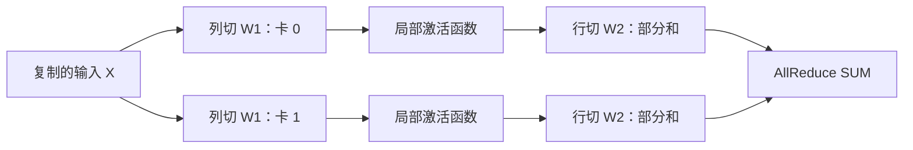

把一份大账单交给四个人算，局部计算可以同时进行；如果每算一行都要开会对账，会议时间很快会超过计算时间。**张量并行的价值来自分摊矩阵计算和权重读取，代价来自层内同步。** 这节把“拆矩阵”和“对账”接起来。

<!-- more -->

## 📑 目录

- [1. 先约定矩阵形状](#1-先约定矩阵形状)
- [2. Column Parallel：切输出通道](#2-column-parallel切输出通道)
- [3. Row Parallel：切输入通道](#3-row-parallel切输入通道)
- [4. Attention 与 KV Head，哪里会卡住](#4-attention-与-kv-head哪里会卡住)
- [5. 通信账本：更多卡为什么可能更慢](#5-通信账本更多卡为什么可能更慢)
- [6. 动手验证：分片后还算同一个函数吗](#6-动手验证分片后还算同一个函数吗)
- [7. 在 vLLM 中怎样选择 TP](#7-在-vllm-中怎样选择-tp)
- [总结](#-总结)
- [自我检验清单](#-自我检验清单)
- [参考资料](#-参考资料)

---

## 1. 先约定矩阵形状

本节采用 $X\in\mathbb{R}^{M\times K}$、$W\in\mathbb{R}^{K\times N}$，省略偏置时 $Y=XW$。这里 $M$ 是本次前向处理的 Token 数；PyTorch `Linear.weight` 的存储形状通常是这里 $W$ 的转置。

模型并行不是改变这个函数，而是改变中间结果在哪里计算、怎样合成。浮点归约次序会影响微小数值误差，数学等价不等于所有平台逐位相同。

## 2. Column Parallel：切输出通道

沿 $N$ 切分权重：

$$
W=[W_0\ W_1\ \cdots\ W_{p-1}],\qquad
Y_i=XW_i,\qquad Y=[Y_0\ \cdots\ Y_{p-1}]
$$

各卡持有同样的输入，独立计算不同输出列。如果后续算子能接收分片输出，就不必立刻 AllGather；若确实需要完整输出，才需要拼接通信。

## 3. Row Parallel：切输入通道

令 $X=[X_0\ \cdots\ X_{p-1}]$，权重按输入维度纵向切成 $W_i$，则：

$$
Y=\sum_{i=0}^{p-1}X_iW_i
$$

这里每卡得到的是**同一输出的部分和**，通常需要 AllReduce 求和，让各卡拿到完整结果。Bias 若在归约前每卡都加一次，会多加 $p$ 倍；正确实现要与算子布局一致。



标准 MLP 可以让第一层列切、第二层行切，中间逐元素激活在本地执行。SwiGLU 等门控结构要让成对通道的分片对应，不能随意把两条分支拆散。

## 4. Attention 与 KV Head，哪里会卡住

Q/K/V 投影可以按 Head 组织分片；各卡在自己负责的 Head 上计算 Attention，再通过输出投影合并。标准 Head 切分通常要求 Query Head 数与 TP 兼容。

GQA/MQA 的 KV Head 数可能小于 Query Head 数。当 TP 增大到 KV Head 无法继续均匀分配时，实现可能复制 KV Head，或对某个组合直接报不支持。于是：

- 权重分片仍可能继续变小；
- 每卡 KV 存储却未必继续按 $1/p$ 下降；
- Attention 后端、模型架构和量化 Kernel 还可能提出额外限制。

📌 **关键点**：从模型配置读 Head 数，再看框架的分片规则。不要把“隐藏维度能整除”当成全部兼容条件。

## 5. 通信账本：更多卡为什么可能更慢

对 $n$ 字节消息，理想 Ring AllReduce 的单 Rank 通信量约为 $2(p-1)n/p$；把每轮链路启动时间记为 $\alpha$，有效传输速率记为 $\beta$，一种简化时间模型是：

$$
T_{\text{AR}}\approx2(p-1)\alpha+\frac{2(p-1)n}{p\beta}
$$

实际实现可能选择树、NVLink 专用算法、融合归约或 ReduceScatter/AllGather，以上只是解释成本的模型。常规稠密 Transformer 的 Attention 输出和 MLP 输出都可能引入归约；不能把固定通信次数套给所有架构与优化实现。

单步时间要同时算：

$$
T_{\text{step}}(p)\approx T_{\text{local}}(p)+T_{\text{comm}}(p)+T_{\text{launch}}(p)
$$

低并发 Decode 的局部矩阵小，通信启动延迟占比容易升高。Prefill 的矩阵更大，更容易摊薄这部分成本，但跨节点带宽仍可能成为瓶颈。

## 6. 动手验证：分片后还算同一个函数吗

下面只用标准库模拟两卡，不发起真实集合通信：

```python
def mm(a, b):
    return [[sum(x * y for x, y in zip(row, col))
             for col in zip(*b)] for row in a]

x = [[1, 2, 3, 4], [4, 3, 2, 1]]
w = [[1, 0, 2, 1], [0, 1, 1, 2],
     [2, 1, 0, 1], [1, 2, 1, 0]]
reference = mm(x, w)

# Column Parallel：局部输出沿列拼回。
columns = [mm(x, [row[:2] for row in w]),
           mm(x, [row[2:] for row in w])]
column_result = [a + b for a, b in zip(*columns)]

# Row Parallel：局部部分和逐元素相加。
a = mm([row[:2] for row in x], w[:2])
b = mm([row[2:] for row in x], w[2:])
row_result = [[u + v for u, v in zip(r0, r1)] for r0, r1 in zip(a, b)]
print(reference)
assert column_result == row_result == reference
```

用整数是为了直接比较结果；真实浮点执行应按误差容忍度验证，不能照搬这里的严格相等。

## 7. 在 vLLM 中怎样选择 TP

v0.19.0 的单节点两卡候选配置如下，假设显存和模型支持满足条件：

```bash
CUDA_VISIBLE_DEVICES=0,1 vllm serve Qwen/Qwen2.5-7B-Instruct \
  --dtype half --tensor-parallel-size 2 \
  --distributed-executor-backend mp --max-model-len 4096
```

先记录 `nvidia-smi topo -m`，再比较 TP=1、TP=2 的低并发 TPOT 和较高并发吞吐。若单卡根本装不下，则 TP=1 不是可执行基线；应比较能装下的配置，而不是编造单卡速度。

NVLink 通常有利于频繁同步，但 PCIe 拓扑、跨 NUMA 路径、网卡亲和性和其他流量都会影响结果。跨节点 TP 可以作为候选，前提是测量过实际通信成本。

## 📝 总结

- 列切输出通常需要拼接语义，行切输入产生部分和，需要求和语义。
- MLP 与 Attention 的布局决定哪些通信可以推迟或融合。
- KV Head 复制会改变 TP 的显存收益。
- TP 增加的是设备协作，性能是否变好取决于局部计算与通信的总账。

## 🎯 自我检验清单

- 能根据 $XW$ 写出两种切分的维度与合成方法
- 能解释为什么行并行不能直接拼接部分和
- 能说明 MLP 两次投影之间为什么可以保留分片
- 能解释小 Batch Decode 为什么容易被通信启动延迟拖慢
- 能列出 Head 数、GPU 拓扑和 Kernel 的兼容检查项

## 📚 参考资料

- [Megatron-LM：张量并行的经典设计](https://arxiv.org/abs/1909.08053)
- [NVIDIA NCCL — Collective Operations](https://docs.nvidia.com/deeplearning/nccl/user-guide/docs/usage/collectives.html)
- [vLLM v0.19.0 — Parallelism and Scaling](https://github.com/vllm-project/vllm/blob/v0.19.0/docs/serving/parallelism_scaling.md)

---

[返回本章](https://caomaolufei.github.io/AIInfraGuide/inference/模块四-推理优化/第6章-分布式推理/) · [上一节](https://caomaolufei.github.io/AIInfraGuide/inference/模块四-推理优化/第6章-分布式推理/61-推理并行策略总览/) · [下一节](https://caomaolufei.github.io/AIInfraGuide/inference/模块四-推理优化/第6章-分布式推理/63-流水线并行推理/)
