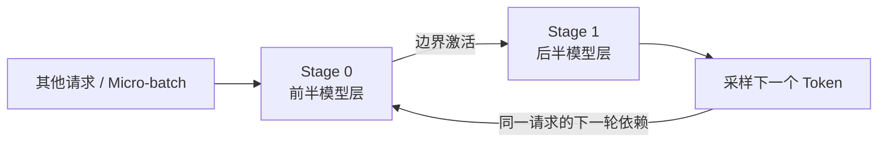

把一家餐厅分成备菜、烹饪、装盘三道工序，可以让不同订单同时推进。但同一份菜仍要按顺序走完三道工序；只有一份订单时，总有人在等待。**PP 分摊了模型层，并没有消除一条请求的前后依赖。**

<!-- more -->

## 📑 目录

- [1. PP 把模型沿层切开](#1-pp-把模型沿层切开)
- [2. Micro-batch 怎样把流水线填起来](#2-micro-batch-怎样把流水线填起来)
- [3. 理想气泡公式，适用范围是什么](#3-理想气泡公式适用范围是什么)
- [4. Decode 的反馈环为什么更难](#4-decode-的反馈环为什么更难)
- [5. 不均匀分层与链路，谁拖慢整条线](#5-不均匀分层与链路谁拖慢整条线)
- [6. 用小模拟器观察气泡与慢阶段](#6-用小模拟器观察气泡与慢阶段)
- [7. TP×PP 的候选怎样落到节点上](#7-tppp-的候选怎样落到节点上)
- [总结](#-总结)
- [自我检验清单](#-自我检验清单)
- [参考资料](#-参考资料)

---

## 1. PP 把模型沿层切开

把 Transformer 划成 $p$ 个 Stage，第 $j$ 个 Stage 持有自己的层与对应 KV：

$$
h_{j+1}=F_j(h_j)
$$

Stage 之间传的是边界激活，通常不是把全模型权重或所有层的 KV 每次都发一遍。Embedding、最终 Norm、LM Head 以及采样位置要按实现放置，它们可能使首尾 Stage 更重。

与每层内部反复同步的 TP 相比，PP 的通信集中在阶段边界，因此常作为跨节点候选。代价是下一阶段必须等上游输出，算力不能简单相加。

## 2. Micro-batch 怎样把流水线填起来

多个独立请求可以组成不同 Micro-batch：第一批到第二阶段时，第一阶段处理下一批。



Micro-batch 不是把一条序列拆成互不依赖的后半段。因果 Attention 的上下文依赖仍然存在；分块 Prefill 的后续 Chunk 也需要此前状态。填流水线依靠的是可调度的独立工作。

## 3. 理想气泡公式，适用范围是什么

先看一个严格简化的模型：$p$ 个等时 Stage，每段耗时 $\tau$；$m$ 个独立 Micro-batch；仅前向；无通信与调度开销。

$$
T_{\text{makespan}}=(m+p-1)\tau,\qquad
U=\frac{m}{m+p-1},\qquad
\text{Bubble}=\frac{p-1}{m+p-1}
$$

启动和排空造成空转。$m$ 增大时利用率提高，但这不代表单请求延迟降低，也不代表应无限增加并发：更多请求需要更多 KV，还会增加排队。

推理没有训练反向，不能直接套用训练的 1F1B 时间表；连续批处理、异步执行和请求结束又会使实际波形偏离这个静态公式。

## 4. Decode 的反馈环为什么更难

同一序列的下一 Token，要等本轮最后阶段产生输出，再把新 Token 带回后续前向。PP 无法把尚未生成的未来 Token 提前交给第一阶段。

因此，低并发 Decode 很容易让多个 Stage 轮流空等。额外独立序列可以补空，但要在 KV 容量、批处理效率和尾延迟之间权衡。若只有一条短请求，PP 的主要价值可能是装载，而不是降低 TPOT。

首 Token 也需要走完整条路径。简化地写：

$$
T_{\text{first-pass}}\approx\sum_j T_j+\sum_j T_{\text{boundary},j}
$$

这是无排队时的路径成本，不包含服务端排队、Tokenizer 和网络响应。

## 5. 不均匀分层与链路，谁拖慢整条线

多批次进入稳态后，最慢 Stage 决定推进节奏，而非平均 Stage 时间。层数一样，不意味着耗时和显存一样：

- MoE 层、长上下文 Attention 和不同算子会改变计算分布；
- Embedding/LM Head 可能使首尾负载不同；
- 每个 Stage 的 KV 容量受本地层数和其他开销影响；
- 跨节点边界传输可能无法完全被计算隐藏。

边界激活的简化数据量为 $M H b$：处理 $M$ 个 Token、隐藏维度 $H$、每元素 $b$ 字节。TP×PP 下还要看边界张量是分片还是复制，不能把这个式子直接当成每条物理网卡的流量。

## 6. 用小模拟器观察气泡与慢阶段

下面的时间单位纯属假设，不模拟真实 vLLM 调度：

```python
def pipeline_time(stage_times, batches):
    assert batches > 0 and all(t > 0 for t in stage_times)
    end = [0.0] * len(stage_times)
    for _ in range(batches):
        upstream = 0.0
        for stage, duration in enumerate(stage_times):
            end[stage] = max(end[stage], upstream) + duration
            upstream = end[stage]
    return end[-1]

assert pipeline_time([1, 1, 1, 1], 1) == 4
assert pipeline_time([1, 1, 1, 1], 8) == 11
assert pipeline_time([1, 3, 1, 1], 8) > 11
for batches in (1, 4, 8):
    elapsed = pipeline_time([1, 1, 1, 1], batches)
    print(batches, elapsed, "理想利用率", batches / elapsed)
```

同样四个 Stage，单批次利用率只有 1/4。八批次的理想利用率为 8/11；慢阶段加入后，还会进一步下降。

## 7. TP×PP 的候选怎样落到节点上

假设两节点、每节点四卡，一个副本用 TP=4、PP=2。期望是节点内四卡形成 TP 组，两个 PP Stage 分别落在两节点。

在已经搭好的 Ray 集群中，v0.19.0 的启动形式为：

```bash
vllm serve /models/target \
  --tensor-parallel-size 4 --pipeline-parallel-size 2 \
  --distributed-executor-backend ray --max-model-len 4096
```

`/models/target` 是各节点一致的模型快照路径。**参数表达期望的并行度，不代替部署后的物理映射核对。** 用 Ray 资源视图、Worker 日志和通信路径确认实际落点；配置外的 GPU、异构节点和资源碎片都可能影响放置。

比较 PP 时，不只看一条请求。分别报告低并发延迟、稳态吞吐、气泡/阶段忙闲和每 Stage 的 KV 余量，才能解释容量与效率的取舍。

## 📝 总结

- PP 沿层切分，阶段间传递边界激活。
- 独立 Micro-batch 可以填流水线，同一请求仍有自回归反馈依赖。
- 气泡公式建立在等时、静态、仅前向的理想条件上。
- 跨节点部署要一起看阶段负载、边界链路和实际 Rank 映射。

## 🎯 自我检验清单

- 能说明 PP Stage 保存哪些权重和 KV
- 能推导四 Stage、八 Micro-batch 的理想利用率
- 能解释增加 Micro-batch 不等于降低单请求延迟
- 能指出为什么训练 1F1B 不能直接当作推理调度
- 能为两节点八卡画出 TP=4、PP=2 的期望映射

## 📚 参考资料

- [GPipe：流水线与 Micro-batch 的经典设计](https://arxiv.org/abs/1811.06965)
- [vLLM v0.19.0 — Parallelism and Scaling](https://github.com/vllm-project/vllm/blob/v0.19.0/docs/serving/parallelism_scaling.md)
- [Ray — Placement Groups](https://docs.ray.io/en/latest/ray-core/scheduling/placement-group.html)

---

[返回本章](https://caomaolufei.github.io/AIInfraGuide/inference/模块四-推理优化/第6章-分布式推理/) · [上一节](https://caomaolufei.github.io/AIInfraGuide/inference/模块四-推理优化/第6章-分布式推理/62-张量并行推理/) · [下一节](https://caomaolufei.github.io/AIInfraGuide/inference/模块四-推理优化/第6章-分布式推理/64-数据并行与专家并行/)
