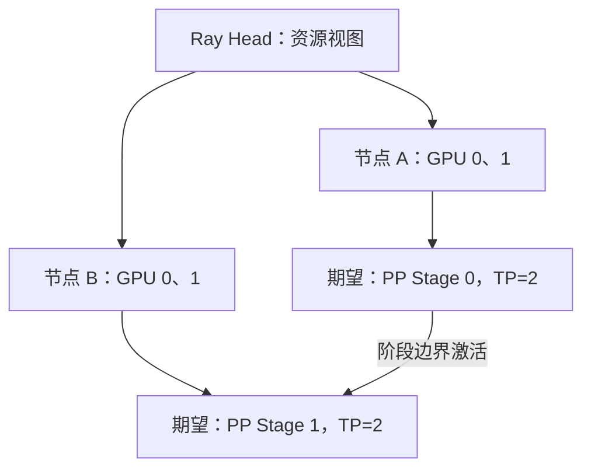

有八张卡，不等于引擎已经知道卡在哪；Ray 能看到八张卡，也不等于 TP 通信走上了正确的链路。可以把 Ray 想成“分配工位的管理员”，把 NCCL 想成“工位之间搬数据的通道”。**编排负责把进程放好，计算通信仍要单独验证。**

<!-- more -->

## 📑 目录

- [1. Ray 与 vLLM，各自负责什么](#1-ray-与-vllm各自负责什么)
- [2. 起集群前，先统一执行环境](#2-起集群前先统一执行环境)
- [3. 两节点 Ray 集群怎样拉起](#3-两节点-ray-集群怎样拉起)
- [4. 资源可见，再检查成组放置](#4-资源可见再检查成组放置)
- [5. 一个服务入口，拉起一个跨节点副本](#5-一个服务入口拉起一个跨节点副本)
- [6. 排错按层走，不靠堆环境变量](#6-排错按层走不靠堆环境变量)
- [7. 从健康检查到可复现部署](#7-从健康检查到可复现部署)
- [总结](#-总结)
- [自我检验清单](#-自我检验清单)
- [参考资料](#-参考资料)

---

## 1. Ray 与 vLLM，各自负责什么

| 组件 | 主要职责 | 不能据此证明什么 |
|---|---|---|
| Head / GCS | 集群资源与控制信息 | 模型一定加载成功 |
| Worker 节点 | 提供 CPU/GPU 等资源 | GPU 通信一定高速 |
| Actor | 长驻执行进程 | 一定独占完整物理机器 |
| Placement Group | 成组申请和放置资源 | 所有模型自动采用最佳拓扑 |
| vLLM GPU Worker | 执行模型分片 | 自动修复网络和环境差异 |

Ray 的资源声明是调度信息，不会凭空生成显存。GPU、CPU 和网络都必须在宿主与容器里实际可用。

## 2. 起集群前，先统一执行环境

两节点至少保持驱动兼容、vLLM/PyTorch/Ray 版本一致、模型和 Tokenizer revision 一致，并能从同一路径读到相同文件。环境变量需要进入实际 Worker，而不只是写在启动客户端的 Shell 中。

```bash
python -c "import torch, vllm, ray; print(torch.__version__, vllm.__version__, ray.__version__)"
nvidia-smi
nvidia-smi topo -m
python -m pip freeze > environment.txt
```

这些命令在各节点分别执行并留档。若基于容器，记录镜像 digest 与启动配置；同一个浮动镜像标签在不同时间可能对应不同内容。

本节以 vLLM v0.19.0 的 Ray 方案为基准。该版本还介绍了多节点 Multiprocessing；选择 Ray 是为了讲清编排，不代表所有多机部署都必须使用 Ray。

## 3. 两节点 Ray 集群怎样拉起

下面假设两节点各两张 GPU，私网地址分别为 `10.0.0.10` 与 `10.0.0.11`。在已安装兼容 Ray 和 vLLM 的相同环境中，分别运行：

```bash
# 节点 A：替换为自己的私网地址。
export VLLM_HOST_IP=10.0.0.10
ray start --head --node-ip-address=10.0.0.10 --port=6379 --num-gpus=2
```

```bash
# 节点 B：VLLM_HOST_IP 必须是本节点地址。
export VLLM_HOST_IP=10.0.0.11
ray start --address=10.0.0.10:6379 --node-ip-address=10.0.0.11 --num-gpus=2
```

这里示范裸环境的集群入口。若使用容器，可改用同一 tag 的 [官方 run_cluster.sh](https://github.com/vllm-project/vllm/blob/v0.19.0/examples/online_serving/run_cluster.sh)，并在容器内部执行后续 vLLM 命令；不要混用宿主 Ray 与容器内 Worker 环境。

Ray 控制通信与模型数据通信需要的端口并不只有 6379。节点地址、端口范围与容器网络必须互通；这些集群内部接口应留在受控私网中，不能作为普通公网服务入口。

## 4. 资源可见，再检查成组放置

```bash
ray status
ray list nodes
```

除了总 GPU 数，还要检查每节点资源和存活状态。四张卡分布在两节点，不等价于一个节点能提供四卡。



Placement Group 按 Bundle 成组保留资源。`PACK`、`SPREAD` 及其严格版本有不同语义，资源碎片可能让请求一直 Pending；具体 vLLM Executor 的放置还需要看版本实现。图是期望映射，运行后必须从日志核对。

## 5. 一个服务入口，拉起一个跨节点副本

确认各节点 `/models/target` 内容一致后，在集群中的一个节点启动一次：

```bash
vllm serve /models/target \
  --tensor-parallel-size 2 --pipeline-parallel-size 2 \
  --distributed-executor-backend ray \
  --served-model-name ray-demo --max-model-len 4096 \
  --host 127.0.0.1 --port 8000
```

TP×PP 总计四卡。一条命令让 Ray Executor 调度 Worker，**不要在两个节点各自再启动一份相同服务来“补齐 Rank”**；那通常会形成两个竞争资源的部署。API 绑定 loopback 方便本机验收，远程接入时另行配置服务入口。

## 6. 排错按层走，不靠堆环境变量

| 层次 | 现象 | 核对证据 |
|---|---|---|
| 环境 | Worker 导入失败、文件不存在 | 版本、路径、容器挂载、模型校验 |
| 编排 | 一直 Pending、GPU 不够 | `ray status`、节点资源与 Placement Group |
| 集合通信 | 初始化挂起或第一步超时 | Rank/GPU 映射、地址、NCCL、网卡 |
| 服务 | 已启动但响应慢 | 队列、KV 抢占、图捕获、输入长度 |

可在对应执行环境设置 `NCCL_DEBUG=INFO`，结合目标集群检查实际网卡与传输。若用 `NCCL_SOCKET_IFNAME`、`GLOO_SOCKET_IFNAME` 等，网卡名应来自实际机器；不要复制教程里的 `eth0` 后就认为修复了通信。

跨机 `NET/Socket` 与预期的 RDMA 路径不同，需要进一步检查设备暴露、网络与驱动。Ray 调度成功不能替代集合通信的小规模测试；也不要用关闭快速链路的临时绕行结果充当正式性能结论。

## 7. 从健康检查到可复现部署

```bash
curl --fail http://127.0.0.1:8000/health
curl --fail http://127.0.0.1:8000/v1/models
```

健康检查通过后，还要发真实生成请求，观察所有预期 Worker 是否执行、KV 容量是否合理，以及输出是否完整。API 可访问并不能证明两节点都实际参与了推理。

结束实验时，先停止这一份服务，再按实验环境的归属回收 Ray 资源；共享集群不要用全局停机命令清理别人的任务。保存部署参数、各节点版本、Rank 放置与日志，下一节再用同一工作负载比较候选。

## 📝 总结

- Ray 解决资源和进程编排，NCCL 等处理模型通信。
- 环境、模型路径、私网地址和 Worker 环境变量要在各节点一致或正确区分。
- TP×PP 的期望映射需要通过实际 Worker 日志验收。
- Pending、通信挂起与服务排队属于不同层次，应分别定位。

## 🎯 自我检验清单

- 能说明 Head、Actor 与 Placement Group 的作用
- 能区分总资源足够与放置约束能够满足
- 能说明为什么两节点的 VLLM_HOST_IP 不应一样
- 能区分一个 Ray 跨机副本与两个独立 API 服务
- 能按环境、编排、通信、服务四层组织排错证据

## 📚 参考资料

- [vLLM v0.19.0 — Parallelism and Scaling](https://github.com/vllm-project/vllm/blob/v0.19.0/docs/serving/parallelism_scaling.md)
- [vLLM v0.19.0 — Distributed Troubleshooting](https://github.com/vllm-project/vllm/blob/v0.19.0/docs/serving/distributed_troubleshooting.md)
- [Ray — Placement Groups](https://docs.ray.io/en/latest/ray-core/scheduling/placement-group.html)
- [NCCL — Troubleshooting](https://docs.nvidia.com/deeplearning/nccl/user-guide/docs/troubleshooting.html)

---

[返回本章](https://caomaolufei.github.io/AIInfraGuide/inference/模块四-推理优化/第6章-分布式推理/) · [上一节](https://caomaolufei.github.io/AIInfraGuide/inference/模块四-推理优化/第6章-分布式推理/64-数据并行与专家并行/) · [下一节](https://caomaolufei.github.io/AIInfraGuide/inference/模块四-推理优化/第6章-分布式推理/66-vllm分布式部署实战/)
