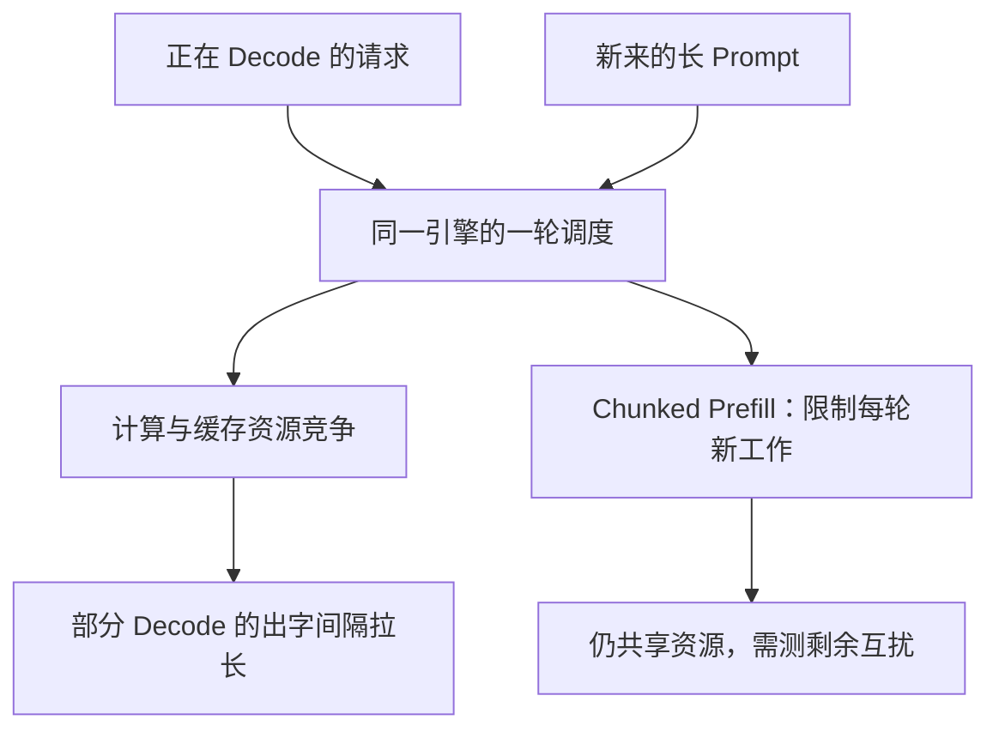

聊天窗口前面还在匀速出字，突然停住一小会，再恢复正常。模型没有换，可能只是另一个长 Prompt 加入了同一份引擎。像高速路上的小车遇到临时并入的重型车辆：**决定这一轮推进速度的，是整批工作的时间，而不是某个 Decode 请求单独需要的时间。**

第 2 章已经用 Chunked Prefill 控制单步工作量。这一章进一步讨论：如果把两类工作放到不同引擎，能换来什么，又要为此付出什么。

<!-- more -->

## 📑 目录

- [1. 两个阶段为什么偏好不同的批次](#1-两个阶段为什么偏好不同的批次)
- [2. 混批怎样拉长某一步](#2-混批怎样拉长某一步)
- [3. 平均 TPOT 会掩盖一次长暂停](#3-平均-tpot-会掩盖一次长暂停)
- [4. 一个可手算的互扰例子](#4-一个可手算的互扰例子)
- [5. Chunked Prefill 与解耦分别改变什么](#5-chunked-prefill-与解耦分别改变什么)
- [6. 怎样做一组公平的互扰实验](#6-怎样做一组公平的互扰实验)
- [总结](#-总结)
- [自我检验清单](#-自我检验清单)
- [参考资料](#-参考资料)

---

## 1. 两个阶段为什么偏好不同的批次

Prefill 一次处理多个输入 Token，矩阵运算较大，常更偏计算密集；低并发 Decode 每条序列每步只推进少量 Token，常更偏权重和 KV 读取。它们是常见趋势，不是脱离模型、长度和批量的绝对分类。

| 阶段 | 常见工作形态 | 主要服务目标 |
|---|---|---|
| Prefill | 处理输入、生成初始 KV | 首 Token 及时到达 |
| Decode | 反复读取历史 KV、逐步生成 | 出字间隔稳定 |

高并发 Decode 也可能接近计算瓶颈；长上下文 Attention 又可能提高访存与通信占比。因此解耦规划先看 Profile，而不是仅凭阶段名称分配硬件。

## 2. 混批怎样拉长某一步

设八条 Decode 请求已在运行，这一步又加入长 Prompt 的 Prefill。它们共享计算、显存带宽、临时工作空间和调度预算。若前向或调度边界不能让 Decode 提前返回，该步输出就会一起延后。



不同实现可能重叠执行或安排不同 Kernel；图描述互扰机制，不假设所有引擎采用完全相同的执行顺序。

## 3. 平均 TPOT 会掩盖一次长暂停

输出 $n\ge2$ 个 Token，首末 Token 的到达时刻为 $t_1,t_n$，请求平均 TPOT 为：

$$
\mathrm{TPOT}=\frac{t_n-t_1}{n-1}
$$

逐个出字间隔为 $\mathrm{ITL}_i=t_i-t_{i-1}$。请求平均 TPOT 的 P95 和全部 Token 间隔的 P95 ITL，是不同统计量；后者会按输出间隔数量给长输出更多权重。

还要区分服务端 Token 生成时间与客户端流式块的到达时间。代理缓冲可能把多个 Token 合成一块，网络分片也不一定对应 Token 边界。只按 TCP 分包计数，不能当作 Token 级 ITL。

## 4. 一个可手算的互扰例子

假设原来每轮 20 ms；某轮额外工作把这一轮变为 100 ms。这里的五倍是**人为设定的时间线**，不是任何 GPU 的实测结论：

```python
import math

def percentile(values, q):
    ordered = sorted(values)
    return ordered[max(0, math.ceil(q * len(ordered)) - 1)]

baseline = [20] * 9
interference = [20] * 8 + [100]
chunked = [20] * 5 + [40] * 4
for label, gaps in [("baseline", baseline), ("mixed", interference),
                    ("chunked-toy", chunked)]:
    print(label, "平均 TPOT", sum(gaps) / len(gaps),
          "P95 ITL", percentile(gaps, 0.95))
assert percentile(interference, 0.95) / percentile(baseline, 0.95) == 5
assert sum(interference) == sum(chunked)
```

把相同的额外时间摊到四轮，降低了最大暂停，却没有消灭全部额外工作。这不是生产调度模拟，也不能据九个样本稳定估计真实 P95；它只说明平均值和尖刺的区别。

## 5. Chunked Prefill 与解耦分别改变什么

Chunked Prefill 限制单轮输入工作量，让 Decode 更频繁获得推进机会；P/D 解耦把两类计算安排到不同引擎，允许分别设置批处理与并行策略。

| 维度 | 调整混合引擎的 Chunk | P/D 解耦 |
|---|---|---|
| 资源隔离 | 仍共享 GPU 与缓存预算 | 计算池可独立配置 |
| 输入计算 | 分多轮完成 | 在 P 池完成 |
| 跨引擎 KV 传输 | 通常不需要 | 必须正确移交 |
| 资源使用 | 两阶段可共用同一份权重 | 两个池各要装载模型 |
| 调度复杂度 | 单引擎内权衡 | 还需路由、传输与池间协调 |

长 Prefill 切小后，TTFT 可能因额外等待增长，也可能因更好的调度/并发而改善，需按负载测量；不能给所有场景预先规定方向。

## 6. 怎样做一组公平的互扰实验

准备 Decode-heavy 和 Prefill-heavy 两类请求，记录到达时刻与实际 Token 数。至少比较 Decode-only、原混合配置、不同 Chunk 预算，以及同样总 GPU 预算的解耦配置。

计算同一类请求的互扰比：

$$
R_{\text{ITL}}=\frac{P95(\mathrm{ITL}_{\text{mixed,decode-group}})}{P95(\mathrm{ITL}_{\text{decode-only}})}
$$

排除预热、模型编译和客户端饱和；对失败、超时与长队列单独计数。混合流中不同请求的样本不能不分组直接合成一个 P95，否则工作负载变化本身也会改变结果。

第 7.6 节给出实际输入与对照矩阵。最终目标是同时守住首字与出字要求，而不是证明某个架构标签天然更快。

## 📝 总结

- P/D 互扰来自共享资源和调度边界，程度随负载变化。
- 平均 TPOT、请求 TPOT 分位数、Token 级 ITL 分位数要分别解释。
- Chunked Prefill 控制单轮工作；解耦增加资源隔离，也引入迁移成本。
- 任何“慢几倍”的结论都应附带模型、硬件、负载和统计口径。

## 🎯 自我检验清单

- 能画出长 Prefill 进入后 Decode 时间线的变化
- 能解释为什么一次长暂停可能被平均 TPOT 掩盖
- 能区分流式网络块与真正的 Token 间隔
- 能说明 Chunked Prefill 与 P/D 解耦的不同成本
- 能设计固定 Decode 请求组的互扰对照

## 📚 参考资料

- [DistServe — USENIX OSDI 2024](https://www.usenix.org/conference/osdi24/presentation/zhong-yinmin)
- [vLLM v0.19.0 — Disaggregated Prefilling](https://github.com/vllm-project/vllm/blob/v0.19.0/docs/features/disagg_prefill.md)
- [vLLM v0.19.0 — Benchmark Serve 指标实现](https://github.com/vllm-project/vllm/blob/v0.19.0/vllm/benchmarks/serve.py)

---

[返回本章](https://caomaolufei.github.io/AIInfraGuide/inference/模块四-推理优化/第7章-pd解耦架构/) · [上一节](https://caomaolufei.github.io/AIInfraGuide/inference/模块四-推理优化/第6章-分布式推理/66-vllm分布式部署实战/) · [下一节](https://caomaolufei.github.io/AIInfraGuide/inference/模块四-推理优化/第7章-pd解耦架构/72-解耦架构设计/)
