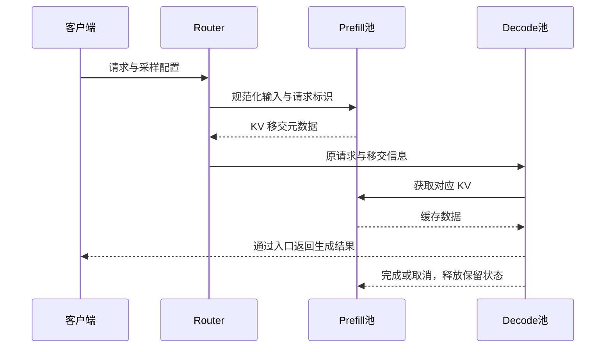

把餐厅的备菜和出餐分到两个区域，还不算完成改造。订单怎样移交、半成品放哪里、哪个区域排队、出餐失败以后谁清理，都需要重新设计。**P/D 解耦是围绕请求状态重组系统，并非把两个服务地址串起来。**

<!-- more -->

## 📑 目录

- [1. 先沿着一条请求走完生命周期](#1-先沿着一条请求走完生命周期)
- [2. DistServe：把阶段与 SLO 一起规划](#2-distserve把阶段与-slo-一起规划)
- [3. Splitwise：阶段特性可以映射到不同硬件](#3-splitwise阶段特性可以映射到不同硬件)
- [4. TaiChi：聚合与解耦之间不只有二选一](#4-taichi聚合与解耦之间不只有二选一)
- [5. Microserving：把移交操作变成可编排接口](#5-microserving把移交操作变成可编排接口)
- [6. 把几种设计放在同一张地图上](#6-把几种设计放在同一张地图上)
- [7. 设计时不能省略的控制面](#7-设计时不能省略的控制面)
- [总结](#-总结)
- [自我检验清单](#-自我检验清单)
- [参考资料](#-参考资料)

---

## 1. 先沿着一条请求走完生命周期

一个基本路径包含：入口规范化输入、选择 Prefill 实例、生成 KV、选择/准备 Decode 实例、移交状态、继续生成并释放资源。

图是一种拉取式示意，系统也可采用推送、分层传输或其他协议。某些实现的 Prefill 请求会先计算一个输出 Token，但最终响应怎样拼装，应由协议明确，避免重复或漏掉首 Token。

## 2. DistServe：把阶段与 SLO 一起规划

DistServe 在 OSDI 2024 中系统讨论 P/D 的资源耦合：如果两阶段共用同一部署计划，TTFT 与 TPOT 的优化容易相互牵制。它将两阶段放在不同 GPU，并结合 SLO 为各阶段选择资源量、并行策略和带宽相关放置。

读这项设计时，重点不是记住论文中的最高倍数，而是看三个决策如何联动：**阶段的单实例能力、需要多少实例、实例放在哪条链路两侧**。不同模型与网络条件下，答案可能不同。

## 3. Splitwise：阶段特性可以映射到不同硬件

Splitwise（ISCA 2024）从阶段的计算、存储、功耗与吞吐差异出发，研究把 Prompt 计算与 Token 生成放到适合它们的机器池。它同时考虑状态转移与硬件组合，以吞吐、成本或功耗为优化目标。

这给出一个有用视角：Decode 不一定需要与 Prefill 完全相同的算力配置。但“使用便宜 GPU”不是免费收益，仍须满足权重/KV 装载、实际 TPOT 与传输条件。本文不把该论文的异构成绩推广到任意 GPU 配对。

## 4. TaiChi：聚合与解耦之间不只有二选一

本章沿用提纲的 TaiChi 名称，对应论文 *Prefill-Decode Aggregation or Disaggregation? Unifying Both for Goodput-Optimized LLM Serving*。其设计讨论不同 TTFT/TPOT 约束下，聚合与解耦各有优势，并通过偏 Prefill、偏 Decode 的实例及调度配置形成混合方式。

它提示读者：可以把资源配比和 Chunk 大小看成调节变量，围绕 Goodput 寻找工作点，而不是先规定“所有请求必须解耦”。论文中的具体调度机制和实验保证，不等同于 vLLM 一个现成开关。

## 5. Microserving：把移交操作变成可编排接口

MLC Microserving 暴露请求内部的细粒度操作，例如准备接收缓存、远端计算/迁移和使用已有状态继续生成，由 Router 组合执行。这里关注的是“让跨引擎流程可编程”的接口层次。

它与 DistServe/Splitwise 的资源规划视角互补，但不是 vLLM KV Connector 的别名。两边的 API、运行时与缓存布局不同，不能直接把一份 Router 脚本换个 URL 当作兼容实现。

## 6. 把几种设计放在同一张地图上

| 方案 | 阅读时的核心问题 | 本地部署还需确认 |
|---|---|---|
| DistServe | 怎样联合规划两阶段的 SLO 与并行资源 | 模型能力、资源配置、链路成本 |
| Splitwise | 怎样匹配阶段与硬件/成本/功耗 | 异构兼容性与迁移开销 |
| TaiChi | 怎样在聚合、解耦与混合之间选工作点 | 调度机制是否实际实现 |
| Microserving | 怎样表达跨引擎细粒度流程 | API、状态所有权、失败清理 |
| vLLM Connector 部署 | 怎样接入某个具体缓存传输实现 | Connector 版本与运行条件 |

前三种是系统方案，Microserving 主要提供编排接口视角，Connector 是引擎内接入点。比较它们时先对齐层次，避免把“支持 KV 传输”误当成“已经有论文的完整调度器”。

## 7. 设计时不能省略的控制面

至少写清四类信息：请求的稳定标识、精确的模型/输入契约、P/D 两端状态的所有者、失败或取消后的释放责任。

选择 Decode 实例应考虑剩余 KV、预计排队与传输距离；P 池不应无上限地生产 D 池接不住的状态。跨阶段重试还需要防止重复生成、重复计费和释放正在读取的 Block。

质量比较应固定模型 revision、Tokenizer、模板、位置编码与采样配置。P/D 的 TP 可以不同，但这要求 Connector 和缓存布局确实支持转换，并通过正确性验证；架构上的自由度不是实现上的自动兼容。

## 📝 总结

- 解耦重新组织的是请求、模型资源与缓存状态的完整生命周期。
- DistServe、Splitwise、TaiChi 分别提供 SLO 规划、硬件匹配与混合配置的视角。
- Microserving 将细粒度操作交给 Router 编排，不能与其他引擎 API 混用。
- 数据通路之外，还需管理准入、路由、故障、取消与资源所有权。

## 🎯 自我检验清单

- 能画出请求、元数据和 KV 各自经过的路径
- 能说明几种方案解决问题的层次差异
- 能解释为何论文中的最高加速比不能直接作为部署承诺
- 能列出异构 P/D 实例的兼容检查项
- 能指出请求取消后需要释放哪些状态

## 📚 参考资料

- [DistServe — OSDI 2024 论文与演讲](https://www.usenix.org/conference/osdi24/presentation/zhong-yinmin)
- [Splitwise: Efficient Generative LLM Inference Using Phase Splitting](https://arxiv.org/abs/2311.18677)
- [TaiChi：统一聚合与解耦的论文](https://arxiv.org/abs/2508.01989)
- [MLC — Microserving LLM Engines](https://blog.mlc.ai/2025/01/07/microserving-llm-engines)
- [MLC — Cross-engine Orchestration Tutorial](https://github.com/mlc-ai/mlc-llm/blob/main/docs/microserving/tutorial.rst)

---

[返回本章](https://caomaolufei.github.io/AIInfraGuide/inference/模块四-推理优化/第7章-pd解耦架构/) · [上一节](https://caomaolufei.github.io/AIInfraGuide/inference/模块四-推理优化/第7章-pd解耦架构/71-混合batching与pd互扰/) · [下一节](https://caomaolufei.github.io/AIInfraGuide/inference/模块四-推理优化/第7章-pd解耦架构/73-kvcache传输与connector/)
