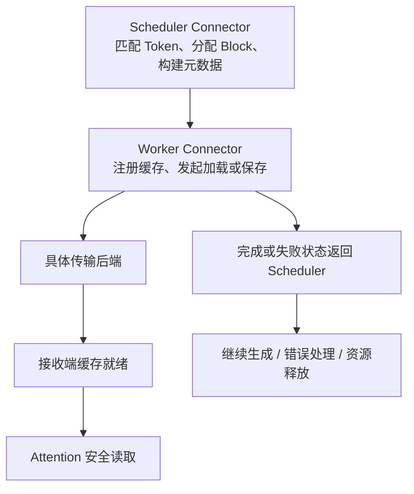

两台服务器都能回答 HTTP 请求，还不能证明它们完成了 P/D 解耦。真正需要交接的是“这段输入已经计算到哪里”的状态，就像接班医生需要完整病历和身份核对，而不仅是床号。**KV 数据、对应的 Token/位置、布局和生命周期必须一起对齐。**

<!-- more -->

## 📑 目录

- [1. KV 移交需要哪些信息](#1-kv-移交需要哪些信息)
- [2. 先算载荷，再估计传输时间](#2-先算载荷再估计传输时间)
- [3. 带宽单位与共享链路](#3-带宽单位与共享链路)
- [4. V1 Connector 的 Scheduler 与 Worker 分工](#4-v1-connector-的-scheduler-与-worker-分工)
- [5. NIXL 与 NCCL，不能混用排错配置](#5-nixl-与-nccl不能混用排错配置)
- [6. 状态生命周期：什么时候才能释放](#6-状态生命周期什么时候才能释放)
- [7. 验证顺序：正确、确实传了、再谈快](#7-验证顺序正确确实传了再谈快)
- [总结](#-总结)
- [自我检验清单](#-自我检验清单)
- [参考资料](#-参考资料)

---

## 1. KV 移交需要哪些信息

除每层 Key/Value 数据，接收端还需要知道请求标识、已计算的 Token 范围、Block 对应关系、模型配置以及传输定位信息。元数据应指向有效且尚未释放的物理缓存。

| 契约 | 不一致可能造成什么 |
|---|---|
| 模型权重/revision、LoRA 等状态 | 相同 Token 对应不同隐藏状态 |
| Tokenizer、模板、完整 Token 序列 | 缓存对应了另一个输入 |
| 位置与 RoPE 配置 | 相同内容却使用了错误的位置状态 |
| dtype、Scale、布局、Head 分片 | 接收端无法正确解释数据 |
| Block 大小与有效长度 | 读取未计算部分或错位位置 |

不能仅靠“模型名称相同”或“Prompt 文本相同”判断兼容。若支持异构布局/TP，转换机制本身也必须经过验证。

## 2. 先算载荷，再估计传输时间

常规 MHA/GQA 模型，全模型 KV 纯数据量约为：

$$
S_{\text{KV}}=2LTH_{\text{KV}}d\,b
$$

取假设结构 $L=32,H_{\text{KV}}=8,d=128,b=2$，输入 $T=8192$，得到 1 GiB 的 KV。它不是任何所选模型的实际配置；MLA、窗口 Attention、量化元数据与缓存命中都要另算。

按有效带宽 $B_{\text{eff}}$，不能重叠的传输时间至少包含：

$$
T_{\text{xfer}}\gtrsim\frac{S_{\text{actually moved}}}{B_{\text{eff}}}
+T_{\text{handshake}}+T_{\text{layout}}+T_{\text{queue}}
$$

层间流水、Prefix Cache 命中和只传完整 Block 会改变实际发送量及暴露在关键路径上的时间。上式不代表必须等全部 Prefill 结束后才能开始任何传输。

## 3. 带宽单位与共享链路

100 Gb/s 的原始线速是 12.5 GB/s，不是 100 GB/s。假设有效率 80%，搬 1 GiB 的纯数据时间下界约为 107 ms；实际还要加协议与排队。

```python
size = 2 * 32 * 8192 * 8 * 128 * 2
assert size == 1024 ** 3
for link_gbps in (100, 400):
    effective_bytes_s = link_gbps * 1e9 / 8 * 0.8
    print(link_gbps, "Gb/s，纯数据下界 ms:", size / effective_bytes_s * 1000)
```

这是带宽算术，不是 RDMA 性能测试。多个请求、Rank 或通信任务共享同一网卡时，不能把网卡标称速率给每个传输各算一份。TP 改变每个 Rank 的数据量，也可能改变并行链路数与重复流量。

## 4. V1 Connector 的 Scheduler 与 Worker 分工

以 vLLM v0.19.0 的 V1 接口为基准，Scheduler 侧决定缓存命中、分配后的状态和传输元数据；Worker 侧处理真实设备缓存、加载、保存与完成通知。



可以从 `get_num_new_matched_tokens`、`build_connector_meta`、`start_load_kv`、`wait_for_layer_load`、`save_kv_layer` 和完成回调理解职责。这些是扩展接口，不是要求用户按顺序手工调用的一份通用客户端脚本；不同 Connector 实现的重叠与同步方式可能不同。

## 5. NIXL 与 NCCL，不能混用排错配置

NIXL 提供传输抽象，v0.19.0 的 NixlConnector 默认使用 UCX，并有异步加载/保存及侧信道握手。NCCL 的 P2P Connector 是另一条实现路线，配置和协议不相同。

`NCCL_SOCKET_IFNAME` 影响相应 NCCL 路径，不能据此配置基于 UCX 的 NIXL 数据通道。后者需检查 UCX 网卡、传输选择、NIXL 构建插件和相关依赖；能通过 HTTP 的链路，也不一定就是 KV 真正使用的链路。

GPUDirect RDMA 让网卡直接访问设备内存，有机会减少 CPU 中转，但需要端到端驱动、设备和网络配置支持。不要从“安装了 NIXL”推断“所有传输都已经走上 RDMA”。

## 6. 状态生命周期：什么时候才能释放

P 侧产生的缓存必须保持有效，直到 D 侧完成所需读取，或按照取消/超时协议回收。发出 HTTP 元数据响应，不等于接收方已经读取全部 GPU 数据。

取消、接收失败与重试至少要明确：

1. 哪个请求拥有哪些 Block，重试有没有新的传输身份；
2. 哪个事件表示读取完成，哪些缓存仍被引用；
3. 谁负责超时清理，是否会释放被并发读取的状态；
4. 出错后是显式失败，还是允许 D 侧重算。

NixlConnector 的 `fail` 策略便于暴露传输错误；`recompute` 可提供另一种恢复路径，却会让 D 侧重新执行 Prefill，重新引入干扰。不能一边发生大量重算，一边把结果称为纯解耦吞吐。

## 7. 验证顺序：正确、确实传了、再谈快

先与聚合基线比较正常输出和结束原因，再核对 Connector 日志、有效接收 Token/Block 与失败计数，确认没有静默回退。最后记录传输字节、可见传输延迟、网络利用率和端到端指标。

某些后端只共享完整 Block，尾部需要补算；这不一定是错误。应结合有效长度解释接收量，而不是要求“接收字节严格等于理论完整 KV”。具体异构布局支持以该 Connector 的版本文档为准。

## 📝 总结

- KV 移交要对齐模型、Token、位置、布局与状态所有权。
- 标称带宽给出的只是乐观下界，实际流量与重叠程度要测量。
- V1 Connector 把调度决策与设备传输分开，具体后端决定同步细节。
- 失败重算会改变 D 池负载，必须计入解耦实验的解释。

## 🎯 自我检验清单

- 能按 MHA/GQA 配置估算 KV 纯数据字节数
- 能把 Gb/s 换成 GB/s，并说明下界遗漏了什么
- 能区分 Scheduler Connector 与 Worker Connector
- 能解释 NIXL/UCX 与 NCCL 环境变量的作用范围
- 能画出移交、取消、失败和回收的状态变化

## 📚 参考资料

- [vLLM v0.19.0 — V1 Connector 基类](https://github.com/vllm-project/vllm/blob/v0.19.0/vllm/distributed/kv_transfer/kv_connector/v1/base.py)
- [vLLM v0.19.0 — NixlConnector Usage Guide](https://github.com/vllm-project/vllm/blob/v0.19.0/docs/features/nixl_connector_usage.md)
- [NIXL 官方项目](https://github.com/ai-dynamo/nixl)
- [vLLM v0.19.0 — P2P NCCL 示例](https://github.com/vllm-project/vllm/tree/v0.19.0/examples/online_serving/disaggregated_serving_p2p_nccl_xpyd)

---

[返回本章](https://caomaolufei.github.io/AIInfraGuide/inference/模块四-推理优化/第7章-pd解耦架构/) · [上一节](https://caomaolufei.github.io/AIInfraGuide/inference/模块四-推理优化/第7章-pd解耦架构/72-解耦架构设计/) · [下一节](https://caomaolufei.github.io/AIInfraGuide/inference/模块四-推理优化/第7章-pd解耦架构/74-goodput与slo感知调度/)
