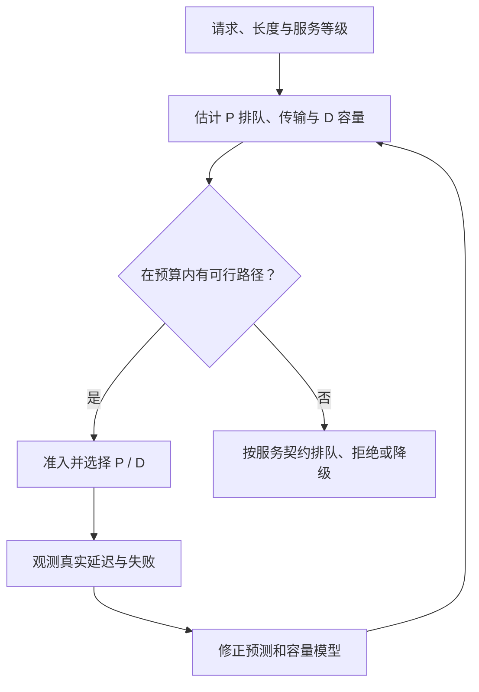

一家快递站每小时处理了一千件包裹，但其中一半都晚到了，不能说按时送达能力有一千件。推理服务也是一样：**Raw QPS 只回答做了多少，Goodput 还要回答这些请求是否在要求的时间和质量条件内完成。**

<!-- more -->

## 📑 目录

- [1. 先把时间指标写成请求级定义](#1-先把时间指标写成请求级定义)
- [2. 联合达标，不能用两个分位数相乘](#2-联合达标不能用两个分位数相乘)
- [3. 一个不依赖 GPU 的计分示例](#3-一个不依赖-gpu-的计分示例)
- [4. SLO 感知调度怎样使用剩余时间](#4-slo-感知调度怎样使用剩余时间)
- [5. 输出长度未知，怎样避免乐观承诺](#5-输出长度未知怎样避免乐观承诺)
- [6. vLLM 的 Goodput 参数怎样解释](#6-vllm-的-goodput-参数怎样解释)
- [7. 从吞吐曲线找服务容量](#7-从吞吐曲线找服务容量)
- [总结](#-总结)
- [自我检验清单](#-自我检验清单)
- [参考资料](#-参考资料)

---

## 1. 先把时间指标写成请求级定义

对请求 $i$，从客户端发出到第一个有效输出的时间为 $\mathrm{TTFT}_i$；生成 $n_i\ge2$ 个 Token 时，首末输出时间差除以 $n_i-1$ 得到平均 $\mathrm{TPOT}_i$。端到端时间还包含完成响应和可能的网络尾部。

这些定义需要明确计时点、代理缓冲、Tokenizer 与失败超时策略。只有一个输出 Token 时，TPOT 的分母为零，应标为不适用并规定该类请求的 SLO；不要拿它和长输出的 TPOT 直接比较。

请求的平均 TPOT 达标，不保证每个 ITL 都达标。如果业务对单次长暂停敏感，应另外设定尾 ITL 或最大间隔约束，并确保观测粒度足够。

## 2. 联合达标，不能用两个分位数相乘

设首字与出字门槛为 $s_F,s_P$，请求成功且质量通过时，定义联合达标指示量：

$$
I_i=\mathbb{1}[\mathrm{success}_i\land\mathrm{quality}_i
\land\mathrm{TTFT}_i\le s_F\land\mathrm{TPOT}_i\le s_P]
$$

固定评测集合与统一观测窗口 $\Delta t$ 后：

$$
G=\frac{\sum_i I_i}{\Delta t},\qquad
R_{\text{pass}}=\frac{\sum_i I_i}{N_{\text{offered}}}
$$

窗口内的请求归属、跨边界请求与排空期要预先约定。失败、超时、拒绝不能偷偷从 offered 分母移除；若按“完成请求”另报成功率，应注明口径差异。

分别有 95% 请求满足 TTFT 和 TPOT，不代表同一批 95% 同时满足两项，也不能直接将两个通过率相乘。最可靠的方法是保留逐请求关联记录。

## 3. 一个不依赖 GPU 的计分示例

下面四条记录均假设输出至少两个 Token，单位为 ms。窗口包含这四条请求的评测活动，示例没有跨窗口请求：

```python
rows = [
    {"ok": True, "quality": True, "ttft_ms": 600, "tpot_ms": 40},
    {"ok": True, "quality": True, "ttft_ms": 1400, "tpot_ms": 30},
    {"ok": True, "quality": True, "ttft_ms": 500, "tpot_ms": 80},
    {"ok": False, "quality": False, "ttft_ms": None, "tpot_ms": None},
]

def meets_slo(row, ttft_ms=1000, tpot_ms=50):
    return (row["ok"] and row["quality"]
            and row["ttft_ms"] is not None and row["tpot_ms"] is not None
            and row["ttft_ms"] <= ttft_ms and row["tpot_ms"] <= tpot_ms)

duration_s = 2.0
passed = sum(meets_slo(row) for row in rows)
print("完成 QPS:", sum(row["ok"] for row in rows) / duration_s)
print("Goodput:", passed / duration_s, "联合通过率:", passed / len(rows))
assert passed == 1
assert passed / duration_s == 0.5
```

这里的门槛是教学示例，不是服务通用标准。真实任务的质量判断可能需要离线评测；性能 CLI 的“Goodput”通常只覆盖配置的时间条件，不自动证明模型回答正确。

## 4. SLO 感知调度怎样使用剩余时间

P 侧可用剩余首字预算估计紧迫性：

$$
\text{slack}_i=s_{F,i}-t_{\text{wait},i}
-\widehat T_{P,i}-\widehat T_{\text{xfer},i}-\widehat T_{D,\text{first},i}
$$

这只是一种调度估计，包含预测误差。若只按最短输入优先，长请求可能饥饿；若只按最早期限优先，也可能让一个已不可挽救的请求拖住很多仍能达标的请求。

可结合请求优先级、等待老化、资源预算与准入控制。D 池还需要保障现有请求的出字节奏，不能只根据新请求 TTFT 把更多缓存塞过去。



## 5. 输出长度未知，怎样避免乐观承诺

输入长度可在 Tokenization 后得知，实际输出长度通常未知。最大输出上限可提供容量约束，但预留全部上限又可能降低利用率。

工程上可以使用长度桶、历史分布和保守余量，持续检查预测偏差。若模型突然开始长链推理，原有短输出容量估计就可能失效。调度器必须允许背压和显式过载处理，而不是依赖预测永远正确。

同样，缓存命中和传输时间也可能变化。只把平均耗时放进预算，会低估尾部排队；需要在目标负载下测量分布。

## 6. vLLM 的 Goodput 参数怎样解释

v0.19.0 的 `vllm bench serve` 可配置时间门槛，例如：

```bash
# 在已有、完整的 benchmark 命令上追加以下参数：
vllm bench serve --help
# --goodput ttft:1000 tpot:50
```

实际使用见 7.6 的完整命令，门槛单位为 ms。该版本按所选请求时间指标联合判断；单 Token 输出的 TPOT 在实现中按 0 处理。若业务需要不同口径，应单独分组或基于逐请求记录重算，不要不加说明地与本节“TPOT 不适用”的定义混用。

`--goodput` 的 TPOT 条件不是每个 ITL 都不超过同一个值。用 `--percentile-metrics ... itl` 可以补充观察，但“报了 P99 ITL”也不等于把它纳入逐请求联合 SLO。

## 7. 从吞吐曲线找服务容量

逐步增加固定到达率，记录 Offered QPS、完成 QPS、Goodput、拒绝/失败、队列和尾延迟。服务容量可以定义为“联合通过率至少达到业务目标时，能接受的最大到达率”，而不是排队已经无限增长时的峰值 Token/s。

Token/s、合格请求/s 和单位 GPU Goodput 应分别报告。长输出会提高 Token 计数权重；用不同输出分布比较时，这几个指标可能朝相反方向变化。

## 📝 总结

- Goodput 依赖明确的请求级成功、时间和质量口径。
- TTFT 与 TPOT 的分位数不能代替同一请求的联合达标判断。
- SLO 调度要考虑剩余预算、长度不确定性、背压与公平性。
- 性能工具的具体定义需要与业务 SLO 对齐。

## 🎯 自我检验清单

- 能区分 Offered QPS、完成 QPS、Goodput 与 Token/s
- 能说明失败和拒绝为什么不能从 offered 分母消失
- 能解释单 Token 输出的 TPOT 口径问题
- 能写出包含传输与 D 侧等待的首字预算
- 能说明 vLLM 的 tpot Goodput 条件为什么不是最大 ITL 条件

## 📚 参考资料

- [DistServe — Goodput-optimized LLM Serving](https://www.usenix.org/conference/osdi24/presentation/zhong-yinmin)
- [vLLM v0.19.0 — Goodput 计算与参数](https://github.com/vllm-project/vllm/blob/v0.19.0/vllm/benchmarks/serve.py)
- [TaiChi — 不同 SLO 下的聚合与解耦](https://arxiv.org/abs/2508.01989)

---

[返回本章](https://caomaolufei.github.io/AIInfraGuide/inference/模块四-推理优化/第7章-pd解耦架构/) · [上一节](https://caomaolufei.github.io/AIInfraGuide/inference/模块四-推理优化/第7章-pd解耦架构/73-kvcache传输与connector/) · [下一节](https://caomaolufei.github.io/AIInfraGuide/inference/模块四-推理优化/第7章-pd解耦架构/75-资源配比与调度挑战/)
