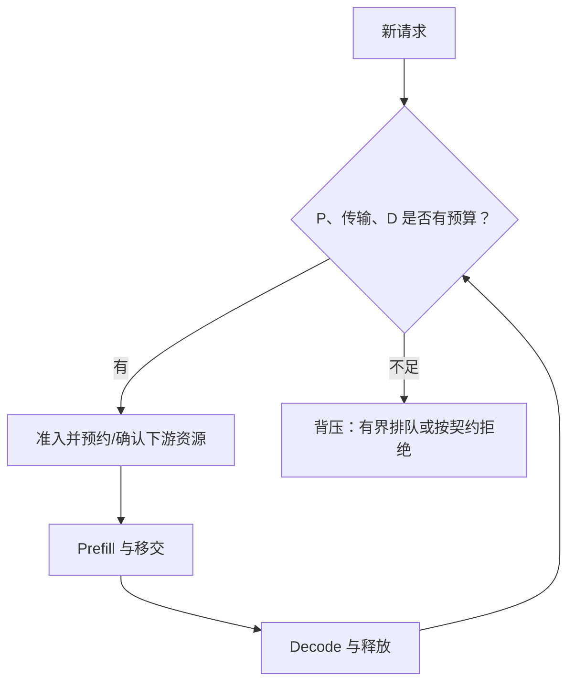

餐厅的备菜员增加一倍，出餐口却没变宽，结果可能只是半成品越堆越多。P/D 解耦以后，两类 GPU 可以独立扩展，也必须独立面对排队。**配比不是把 GPU 对半分，而是让计算、缓存和传输都能接住同一股请求流。**

<!-- more -->

## 📑 目录

- [1. 先用实例能力，建立可解释的起点](#1-先用实例能力建立可解释的起点)
- [2. 请求数、Token 数与实例服务时间](#2-请求数token-数与实例服务时间)
- [3. 从实例数换成 GPU 数](#3-从实例数换成-gpu-数)
- [4. 网络是一项独立的容量约束](#4-网络是一项独立的容量约束)
- [5. KV 驻留与背压，不能等 OOM 才处理](#5-kv-驻留与背压不能等-oom-才处理)
- [6. 流量变化后，静态配比怎样失效](#6-流量变化后静态配比怎样失效)
- [7. 什么时候不值得解耦](#7-什么时候不值得解耦)
- [总结](#-总结)
- [自我检验清单](#-自我检验清单)
- [参考资料](#-参考资料)

---

## 1. 先用实例能力，建立可解释的起点

设到达率为 $\lambda$ 请求/s；在指定请求分布与批处理策略下，一个 P 实例、D 实例的有效服务能力分别为 $\mu_P,\mu_D$。保守的负载约束为：

$$
\rho_P=\frac{\lambda}{n_P\mu_P}<1,\qquad
\rho_D=\frac{\lambda}{n_D\mu_D}<1
$$

这里的能力应来自同一输入/输出分布、同一硬件和配置，不能从 Prefill 的瞬时 Token/s 与 Decode 的总 Token/s 直接相除。服务接近满载时，尾部等待可能很大，$\rho<1$ 也不保证 SLO。

把每请求的平均实例服务需求写为 $s_P=1/\mu_P$、$s_D=1/\mu_D$，相近目标利用率下，初始实例比例约为 $n_P/n_D\approx s_P/s_D$。这是工作负载相关的容量近似，不是通用比例。

## 2. 请求数、Token 数与实例服务时间

若使用 Token 级容量估计，需要同时知道输入长度、输出长度与批次效率。输入翻倍不一定使 Prefill 耗时严格翻倍，长上下文 Attention 和缓存命中会改变关系；Decode 还受活跃序列数与历史长度影响。

可以先按输入/输出长度分桶，实测每个桶的服务需求，再用真实流量权重汇总。直接取一次请求的端到端时间，里面混入的排队不能当成纯计算服务需求。

## 3. 从实例数换成 GPU 数

假设一个 P 实例内部使用 $g_P$ 张卡，一个 D 实例使用 $g_D$ 张卡：

$$
N_{\text{GPU}}=n_Pg_P+n_Dg_D
$$

P 的 TP=4、D 的 TP=2 时，两个池的“1:1 实例数”实际是“2:1 GPU 数”。不同 GPU 型号还要换成成本或功耗预算，不能只数卡。

下面给出纯假设规划，输出不是部署建议：

```python
import math

arrival_rps = 12
service_p_s, service_d_s = 0.08, 0.24
target_utilization = 0.6
n_p = math.ceil(arrival_rps * service_p_s / target_utilization)
n_d = math.ceil(arrival_rps * service_d_s / target_utilization)
g_p, g_d = 2, 1
print("P/D 实例:", n_p, n_d, "GPU:", n_p * g_p + n_d * g_d)
assert (n_p, n_d) == (2, 5)
assert n_p * g_p + n_d * g_d == 9
```

这里的服务需求已经假定对应一种批处理工作点。改变并发、TP 或 GPU 后，需要重新测量，不能沿用常数。

## 4. 网络是一项独立的容量约束

设每请求平均跨网络迁移 $E[S_{\text{KV}}]$ 字节，一个共享路径的有效总带宽为 $B$，则至少需要：

$$
\lambda E[S_{\text{KV}}]<B
$$

多条独立链路可分别核算，不能把同一共享链路的带宽重复分配。短时并发传输造成的尾延迟，也可能在平均条件满足时违反首字预算。

增加 P 实例却没有增加瓶颈网卡，只会更快地产生等待传输的状态。应该共同观察生成 KV 的速率、实际迁移速率与待迁移字节。

## 5. KV 驻留与背压，不能等 OOM 才处理

P 已算完、D 还没接收的请求，会继续占用 P 侧缓存。若这类状态平均停留 $E[W_{\text{hold}}]$ 秒，稳定条件下可用 Little 定律估计数量：

$$
E[N_{\text{hold}}]=\lambda E[W_{\text{hold}}]
$$

占用字节更一般地与 $\lambda E[S_{\text{KV}}W_{\text{hold}}]$ 相关；长请求可能同时更大、等待更久，不能总写成两个均值的乘积。



背压应尽早让上游知道下游接不住，避免囤积已经计算好的昂贵 KV。取消、失败和超时回收也属于容量控制的一部分。

## 6. 流量变化后，静态配比怎样失效

长输入增多，P 与网络压力可能上升；长输出增多，D 驻留与 KV 容量可能先成为瓶颈。前缀命中率、工具调用、多轮对话和推理长度变化，都可能让昨天的比例不再合适。

扩缩容需要加载权重、预热与建立传输连接，不是瞬时切换。可以使用分桶监控、平滑窗口和迟滞，避免每次抖动都迁移资源；故障或突发时还要保留恢复余量。

## 7. 什么时候不值得解耦

| 条件 | 可能更合适的第一步 |
|---|---|
| 低流量、两阶段没有明显互扰 | 聚合引擎，减少重复权重与迁移 |
| Chunk 调整后已满足 SLO | 先保留简单配置作为基线 |
| 短请求、网络开销占比较高 | 测量移交成本能否被收益覆盖 |
| KV 超大、链路或驻留预算不足 | 先解决网络、缓存或准入瓶颈 |
| 两阶段 SLO/硬件需求明显不同 | 将解耦纳入候选并验证 |

最终可以枚举可行的实例配置，以相同 GPU 或成本预算比较 SLO 下的 Goodput。纸面配比用于缩小搜索范围，不能替代完整系统压测。

## 📝 总结

- 初始比例来自同一工作负载下的阶段服务需求。
- 实例数与 GPU 数不同，还要计入各实例内部的 TP/PP。
- 计算能力、迁移带宽、KV 驻留和排队余量需要同时满足。
- 静态配比会随长度分布与缓存命中变化，背压是必要机制。

## 🎯 自我检验清单

- 能把阶段服务需求换成有余量的实例数量
- 能解释 1:1 实例数为什么不一定是 1:1 GPU 数
- 能写出共享网络的平均容量约束
- 能用 Little 定律解释待移交 KV 为什么会堆积
- 能说明何时先调 Chunk，而不是直接拆分 GPU 池

## 📚 参考资料

- [DistServe — 资源规划与带宽相关放置](https://www.usenix.org/conference/osdi24/presentation/zhong-yinmin)
- [Splitwise — 阶段与硬件资源匹配](https://arxiv.org/abs/2311.18677)
- [TaiChi — 聚合、解耦与混合工作点](https://arxiv.org/abs/2508.01989)
- [vLLM v0.19.0 — NixlConnector 生命周期与失败策略](https://github.com/vllm-project/vllm/blob/v0.19.0/docs/features/nixl_connector_usage.md)

---

[返回本章](https://caomaolufei.github.io/AIInfraGuide/inference/模块四-推理优化/第7章-pd解耦架构/) · [上一节](https://caomaolufei.github.io/AIInfraGuide/inference/模块四-推理优化/第7章-pd解耦架构/74-goodput与slo感知调度/) · [下一节](https://caomaolufei.github.io/AIInfraGuide/inference/模块四-推理优化/第7章-pd解耦架构/76-vllm-pd解耦实战/)
