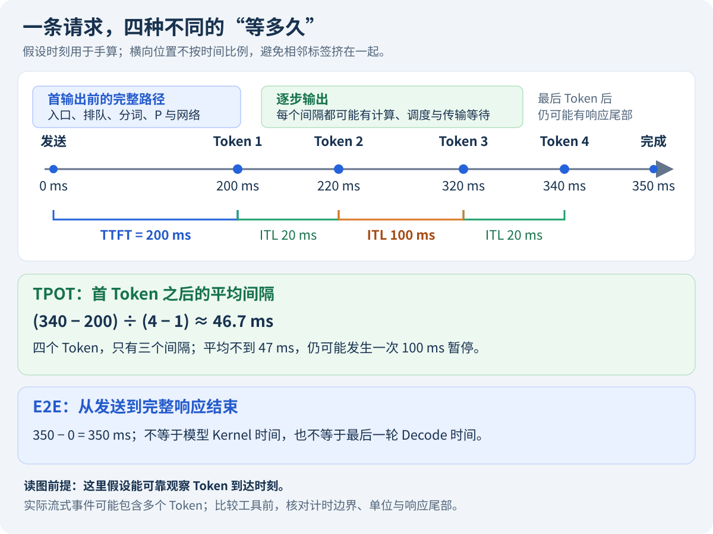

两家餐厅每小时都能出一百份饭，一家三分钟就上第一道菜，另一家让顾客先等半小时，显然不是同一种体验。大模型推理也一样：**吞吐回答整个服务做了多少，延迟回答某位用户等了多久。** 本节先建立一张能读懂的成绩单，再讨论怎样压测。

如果还不熟悉术语：请求是一位用户的一次调用；Prompt 是输入；Token 是模型处理的文本单位，不固定等于一个汉字；Prefill 处理输入并建立 KV Cache，Decode 逐步生成后续输出。

<!-- more -->

## 📑 目录

- [1. 先画一条请求的时间线](#1-先画一条请求的时间线)
  - [1.1 为什么要先约定在哪里计时](#11-为什么要先约定在哪里计时)
  - [1.2 用五个时刻手算](#12-用五个时刻手算)
  - [1.3 流式事件不一定是一个 Token](#13-流式事件不一定是一个-token)
- [2. 平均值、P95 与长尾分别在说什么](#2-平均值p95-与长尾分别在说什么)
  - [2.1 平均速度会掩盖一次暂停](#21-平均速度会掩盖一次暂停)
  - [2.2 要先说清楚给什么样本排序](#22-要先说清楚给什么样本排序)
- [3. 请求吞吐、Token 吞吐与 Goodput](#3-请求吞吐token-吞吐与-goodput)
  - [3.1 同样叫吞吐，分子可能不同](#31-同样叫吞吐分子可能不同)
  - [3.2 一组小记录足以看出差别](#32-一组小记录足以看出差别)
  - [3.3 窗口要覆盖同一个集合](#33-窗口要覆盖同一个集合)
- [4. 显存和 GPU 利用率为什么还要单独看](#4-显存和-gpu-利用率为什么还要单独看)
  - [4.1 显存占用不等于还有多少请求能进来](#41-显存占用不等于还有多少请求能进来)
  - [4.2 GPU 利用率高不保证请求合格](#42-gpu-利用率高不保证请求合格)
- [5. 把指标组织成一张可以解释的报告](#5-把指标组织成一张可以解释的报告)
  - [5.1 每一行成绩都附带实验条件](#51-每一行成绩都附带实验条件)
  - [5.2 自己做一次诊断练习](#52-自己做一次诊断练习)
- [总结](#-总结)
- [自我检验清单](#-自我检验清单)
- [参考资料](#-参考资料)

---

## 1. 先画一条请求的时间线

### 1.1 为什么要先约定在哪里计时

从用户点击发送到看到回答，中间可能经过客户端、网关、队列、Tokenizer、模型和网络。同一请求在服务端记录“计算了 100 ms”，客户端却可能等了 500 ms，因为其余时间花在队列和传输上。



图中的毫秒是教学假设。**客户端时钟用来描述体验，服务端分段计时用来定位原因**，两边需要关联请求，但不能把两个不同机器的时钟直接相减当作准确耗时。

### 1.2 用五个时刻手算

假设请求在 0 ms 发出，四个输出 Token 分别在 200、220、320、340 ms 被可靠观测到，完整响应在 350 ms 结束：

| 量 | 计算 | 含义 |
|----|------|------|
| 首 Token 延迟 TTFT | $200-0=200$ ms | 多久开始有有效输出 |
| 相邻间隔 ITL | 20、100、20 ms | 哪一步发生暂停 |
| 请求平均 TPOT | $(340-200)/(4-1)\approx46.7$ ms | 首 Token 后平均每步等多久 |
| 端到端时间 E2E | $350-0=350$ ms | 整条请求何时彻底结束 |

分母是三个间隔，不是四个 Token。只有一个输出 Token 时，这个 TPOT 定义不适用，应另行规定统计规则。

### 1.3 流式事件不一定是一个 Token

客户端可能一次收到多个 Token 的内容，代理也可能缓冲输出。SSE 事件、TCP 分包和 Token 不是天然一一对应。报告“ITL”时应说明是服务端 Token 时间、客户端事件间隔，还是工具根据输出记录计算的指标。

vLLM v0.19.0 的压测实现还会用客户端请求完成延迟减去 TTFT，再除以输出长度减一来计算请求 TPOT，因此响应尾部也可能影响结果。**工具名字一样，不代表所有计时边界都一样。**

## 2. 平均值、P95 与长尾分别在说什么

### 2.1 平均速度会掩盖一次暂停

上一张表里平均 TPOT 不到 47 ms，但其中一次暂停达到 100 ms。假如输出更长，这次暂停还会被更多正常间隔摊薄。用户说“中间突然卡了一下”，平均值未必能清楚地反映出来。

P95 可以理解为把样本从小到大排列后，靠近 95% 位置的值；P99 更靠近尾部。实际工具可能使用插值或其他分位数算法，需要保存版本和口径。P95 不是“最慢那个请求”，也不是“95% 的时间 GPU 很忙”。

### 2.2 要先说清楚给什么样本排序

请求 TPOT P95：先给每条请求算一个平均 TPOT，再对请求排序。全体 ITL P95：对很多次输出间隔排序，长输出会提供更多间隔，权重也更大。这两列不能互相替代。

不要平均多个副本的 P95 来当集群 P95。副本样本数不同、分布不同，分位数无法这样合成；应该合并原始样本，或在同一口径下聚合直方图后估计。

📌 **关键点**：样本少时，P99 很容易被少量观测左右。先看成功数、样本量和多轮波动，再解释尾部，不能只挑一个漂亮的分位数。

## 3. 请求吞吐、Token 吞吐与 Goodput

### 3.1 同样叫吞吐，分子可能不同

| 指标 | 一个常见口径 | 容易混淆的地方 |
|------|--------------|----------------|
| Offered QPS | 尝试提交请求数 / 时间 | 不等于服务实际接受或完成的速率 |
| 完成 QPS | 成功完成请求数 / 时间 | 不代表这些请求都及时或质量正确 |
| 输出 Token/s | 成功生成的输出 Token 总数 / 时间 | 长输出占更大权重 |
| 总 Token/s | 输入加输出 Token 总数 / 时间 | 长输入会明显改变分子 |
| 请求 Goodput | 满足规定条件的请求数 / 时间 | 必须定义成功、SLO、质量与窗口 |

SLO 是服务等级目标，例如首字不超过 1000 ms、后续平均间隔不超过 50 ms。门槛由业务确定，这两个数字只是本章教学例子。

### 3.2 一组小记录足以看出差别

下面程序只用标准库，不访问 GPU。四条请求属于同一有限评测批次，正式发流到最后完成/超时共 2 秒，输出都至少两个 Token：

```python
records = [
    {"ok": True, "quality": True, "ttft": 600, "tpot": 40, "out": 20},
    {"ok": True, "quality": True, "ttft": 1400, "tpot": 30, "out": 15},
    {"ok": True, "quality": True, "ttft": 500, "tpot": 80, "out": 10},
    {"ok": False, "quality": False, "ttft": None, "tpot": None, "out": 0},
]
duration_s = 2
passed = [r for r in records if r["ok"] and r["quality"]
          and r["ttft"] <= 1000 and r["tpot"] <= 50]
print("尝试 QPS:", len(records) / duration_s)
print("完成 QPS:", sum(r["ok"] for r in records) / duration_s)
print("输出 Token/s:", sum(r["out"] for r in records) / duration_s)
print("Goodput:", len(passed) / duration_s)
assert len(passed) == 1
assert sum(r["out"] for r in records) == 45
```

结果分别是 2、1.5、22.5 和 0.5。三条成功中，一条首字太慢，一条出字太慢，只有一条联合达标。失败不能从尝试总数中消失，时间达标也不能自动代替质量判断。

### 3.3 窗口要覆盖同一个集合

有限批次可以从正式发流开始，一直计到最后完成或超时，把排空期纳入时间。持续线上流量则需要明确按到达还是完成归属、窗口外结束的请求如何追踪。不能拿一分钟内的全部成功数，除以其中最忙的十秒。

更不能把两个独立客户端各自窗口里的 req/s 直接相加，当成同一窗口的系统 Goodput。第七章已经讨论过这种混合负载陷阱。

## 4. 显存和 GPU 利用率为什么还要单独看

### 4.1 显存占用不等于还有多少请求能进来

显存里同时有权重、KV、激活、工作空间和运行时状态。引擎可能提前分配 KV 池，所以两次 `nvidia-smi` 显示差不多，不代表剩余缓存容量相同。

要同时看引擎的 KV 使用率、活跃/等待请求、抢占，以及每条请求的上下文。PyTorch 的 allocated、reserved 与设备总显存占用又是不同观察范围，不能把其中一个直接命名为整个服务的峰值。

### 4.2 GPU 利用率高不保证请求合格

GPU 利用率常描述采样窗口内设备执行活动，不等于计算单元达到理论峰值，也不等于用户没有排队。持续做低效计算、反复重算或队列积压，都可能让设备很忙、体验很差。

反过来，低并发低延迟服务可能有空闲时间。应先确认负载是否足够，再结合带宽、算子、通信和队列找瓶颈。不要把“打满 100%”设成独立于 SLO 的目标。

## 5. 把指标组织成一张可以解释的报告

### 5.1 每一行成绩都附带实验条件

至少记录模型/Tokenizer revision、精度、GPU 和互联、框架版本、输入输出分布、缓存策略、并发或到达率、预热方式、成功/失败、样本量和时间窗口。

| 层次 | 建议先看 | 回答的问题 |
|------|----------|------------|
| 用户体验 | TTFT、TPOT、ITL、E2E | 首字慢，还是中间卡 |
| 服务容量 | 尝试/完成速率、Goodput、队列 | 能持续接住多少合格请求 |
| 资源 | 权重/KV、峰值、设备活动、通信 | 哪一种资源接近约束 |
| 正确性 | 文本、结束原因、任务质量 | 是否只是变短、截断或出错 |

### 5.2 自己做一次诊断练习

如果总 Token/s 上涨，但输出 Token/s 不变，先检查输入是否变长；如果 TPOT 平均值稳定而用户仍投诉暂停，检查 ITL 和代理缓冲；如果完成 QPS 很高但 Goodput 低，按同一请求关联首字、出字、失败和质量。

这些只是下一步调查方向。指标告诉我们发生了什么，时间线和原始记录才能继续解释原因。下一节开始把这张报告真正测出来。

## 📝 总结

- 延迟描述一条请求的等待，吞吐描述整个服务的产出。
- TTFT、请求平均 TPOT、逐次 ITL 与 E2E 有不同计时边界。
- Goodput 需要逐请求联合判断与统一窗口，不能只看成功数。
- 显存与 GPU 活动是定位证据，应与队列、工作量和质量一起解释。

## 🎯 自我检验清单

- 能从四个到达时刻手算 TTFT、ITL 和 TPOT
- 能解释请求 P95 与 Token 间隔 P95 的不同样本权重
- 能区分输出 Token/s、总 Token/s、完成 QPS 和 Goodput
- 能说明失败、截断与输出变短为何会干扰性能结论
- 能解释预分配 KV 池与 `nvidia-smi` 显存占用的关系
- 能为一条成绩补齐模型、负载、资源和窗口条件

## 📚 参考资料

- [vLLM v0.19.0 — Benchmark Serve 指标源码](https://github.com/vllm-project/vllm/blob/v0.19.0/vllm/benchmarks/serve.py)
- [vLLM v0.19.0 — Metrics Design](https://github.com/vllm-project/vllm/blob/v0.19.0/docs/design/metrics.md)
- [Prometheus — Histograms and Summaries](https://prometheus.io/docs/practices/histograms/)

---

[返回本章](https://caomaolufei.github.io/AIInfraGuide/inference/模块四-推理优化/第8章-性能分析与benchmark/) · [上一节](https://caomaolufei.github.io/AIInfraGuide/inference/模块四-推理优化/第7章-pd解耦架构/76-vllm-pd解耦实战/) · [下一节](https://caomaolufei.github.io/AIInfraGuide/inference/模块四-推理优化/第8章-性能分析与benchmark/82-压测工具与可复现实验/)
