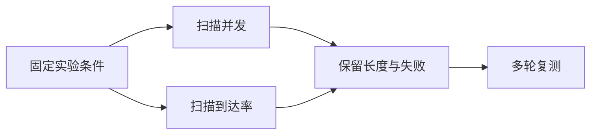
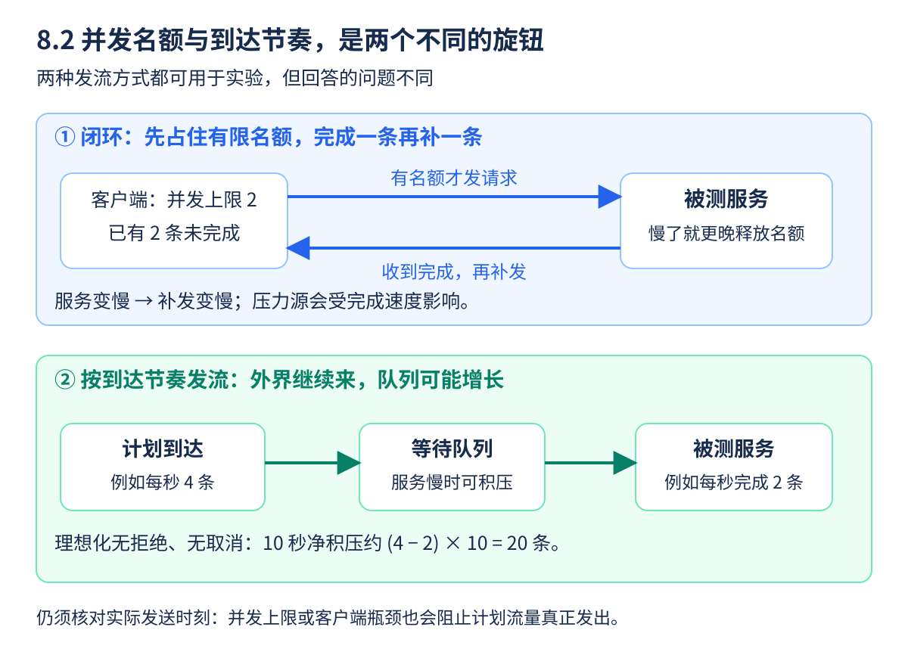

测跑步成绩，要先确认距离、起点和计时规则。推理压测也是如此：一个工具测整批本地生成，另一个测经过 HTTP 的流式请求，即使都输出“每秒 Token”，也不能直接排快慢。

本节采用与前文一致的 **vLLM v0.19.0** 接口基线，给出可逐步执行的 Linux Bash 流程。代码中的 GPU 成绩需要在实际设备测量；本节不预设最优配置。

<!-- more -->

## 📑 目录

- [1. 三种 bench，分别回答什么问题](#1-三种-bench分别回答什么问题)
  - [1.1 离线和在线的差别不只是有没有网络](#11-离线和在线的差别不只是有没有网络)
  - [1.2 先保存帮助和环境](#12-先保存帮助和环境)
- [2. 先跑小规模离线实验](#2-先跑小规模离线实验)
  - [2.1 固定一个批次测延迟](#21-固定一个批次测延迟)
  - [2.2 再看离线总任务速度](#22-再看离线总任务速度)
- [3. 在线实验：一个终端开服务，一个终端发请求](#3-在线实验一个终端开服务一个终端发请求)
  - [3.1 终端 A：启动并保持运行](#31-终端-a启动并保持运行)
  - [3.2 终端 B：先确认服务可用](#32-终端-b先确认服务可用)
  - [3.3 同一负载下扫描并发](#33-同一负载下扫描并发)
- [4. 并发和到达率，不是一个旋钮](#4-并发和到达率不是一个旋钮)
  - [4.1 闭环：空一个位置，再补一条](#41-闭环空一个位置再补一条)
  - [4.2 到达流：外界按节奏持续来](#42-到达流外界按节奏持续来)
  - [4.3 用两条数据流看出差别](#43-用两条数据流看出差别)
- [5. GenAI-Perf、Perf Analyzer 和自定义脚本](#5-genai-perfperf-analyzer-和自定义脚本)
  - [5.1 不同工具先对齐协议与定义](#51-不同工具先对齐协议与定义)
  - [5.2 自定义脚本至少记录什么](#52-自定义脚本至少记录什么)
- [6. 可复现报告与新手练习](#6-可复现报告与新手练习)
  - [6.1 把一次实验当成一张配置卡](#61-把一次实验当成一张配置卡)
  - [6.2 没有 GPU 时也能先完成什么](#62-没有-gpu-时也能先完成什么)
- [总结](#-总结)
- [自我检验清单](#-自我检验清单)
- [参考资料](#-参考资料)

---

## 1. 三种 bench，分别回答什么问题

| 工具 | 被测路径 | 更适合回答 | 不能直接回答 |
|------|----------|------------|--------------|
| `vllm bench latency` | 本地引擎处理固定批次 | 这批生成需要多久 | 在线排队下的用户 TTFT |
| `vllm bench throughput` | 离线引擎处理一组请求 | 批量任务完成速度 | 真实到达流下能否守住 SLO |
| `vllm bench serve` | 访问运行中的 HTTP 服务 | 端到端吞吐、流式延迟与失败 | 原因是否一定在某个 Kernel |

### 1.1 离线和在线的差别不只是有没有网络

离线往往知道全部任务，可以持续给引擎喂工作；在线则有请求何时到达、在入口和引擎里怎样等待的问题。相同模型在两个模式下表现不同，并不矛盾。

先用离线验证局部能力，再用在线检查用户体验，是一种学习顺序。正式优化在线服务时，应把在线结果作为对应目标的证据，不能拿离线峰值替代。

### 1.2 先保存帮助和环境

以下命令在已安装兼容 v0.19.0 的环境执行，不要求重新覆盖现有环境：

```bash
mkdir -p results
python -m pip freeze > results/environment.txt
nvidia-smi > results/gpus.txt
vllm bench latency --help > results/latency-help.txt
vllm bench throughput --help > results/throughput-help.txt
vllm bench serve --help > results/serve-help.txt
```

帮助文件记录这次实际接口；还应保存驱动、镜像、模型和 Tokenizer 提交 revision。后文仓库名便于演示，严肃对照应替换成固定模型快照路径。

## 2. 先跑小规模离线实验

### 2.1 固定一个批次测延迟

假设模型和运行开销能装下所选 GPU，先单独运行：

```bash
MODEL=Qwen/Qwen3-0.6B
CUDA_VISIBLE_DEVICES=0 vllm bench latency \
  --model "$MODEL" --dtype half --max-model-len 4096 \
  --input-len 128 --output-len 32 --batch-size 1 \
  --num-iters-warmup 2 --num-iters 10 \
  --enforce-eager --output-json results/offline-latency.json
```

`batch-size` 是固定批次大小；`num-iters-warmup` 是正式计时前预热轮数；`num-iters` 是测量轮数。这里的少量轮次用于初步跑通，不足以得出稳定的线上尾延迟。

`--enforce-eager` 减少图捕获变量，适合初次理解，但会改变性能。启用 CUDA Graph 后要重新测全部候选，不能只优化某一组。

### 2.2 再看离线总任务速度

上一进程退出并释放资源后，再运行另一项实验：

```bash
CUDA_VISIBLE_DEVICES=0 vllm bench throughput \
  --model "$MODEL" --dtype half --max-model-len 4096 \
  --dataset-name random --input-len 128 --output-len 32 \
  --num-prompts 32 --enforce-eager
```

32 条请求与“一次只测 batch=1”不是同一个工作负载。分别记录两种工具结果即可，不要用一个结果推导另一个的在线 QPS。

## 3. 在线实验：一个终端开服务，一个终端发请求

### 3.1 终端 A：启动并保持运行

```bash
MODEL=Qwen/Qwen3-0.6B
CUDA_VISIBLE_DEVICES=0 vllm serve "$MODEL" \
  --served-model-name bench-demo --dtype half \
  --max-model-len 4096 --max-num-seqs 16 \
  --max-num-batched-tokens 4096 --gpu-memory-utilization 0.85 \
  --no-enable-prefix-caching --generation-config vllm \
  --enforce-eager --seed 42 --host 127.0.0.1 --port 8000
```

`bench-demo` 是 API 别名，不是下载仓库。`max-model-len` 限制单序列输入与输出的总上下文；`max-num-seqs` 限制活跃序列；`max-num-batched-tokens` 是单轮调度 Token 预算。显存比例也不是计算利用率。

基础实验关闭前缀缓存以减少复用造成的变量，但仍保留普通生成所需 KV。研究前缀缓存时应另建实验组，并报告命中情况。

### 3.2 终端 B：先确认服务可用

两个终端都进入同一 Python 环境；变量不会自动共享。先发送正常请求，而不是立即压满：

```bash
curl --fail http://127.0.0.1:8000/health
curl --fail http://127.0.0.1:8000/v1/completions \
  -H 'Content-Type: application/json' \
  -d '{"model":"bench-demo","prompt":"17 + 25 =","max_tokens":16,"temperature":0}'
```

检查文本、结束原因和实际用量。健康成功只表示服务健康检查通过，不能证明质量、并发容量或目标 SLO。

### 3.3 同一负载下扫描并发

```bash
MODEL=Qwen/Qwen3-0.6B
for concurrency in 1 4 8; do
  vllm bench serve --backend openai \
    --base-url http://127.0.0.1:8000 --endpoint /v1/completions \
    --model bench-demo --tokenizer "$MODEL" \
    --dataset-name random --input-len 512 --output-len 128 \
    --num-prompts 128 --num-warmups 8 \
    --request-rate inf --max-concurrency "$concurrency" \
    --temperature 0 --ignore-eos --seed 42 \
    --goodput ttft:1000 tpot:50 \
    --percentile-metrics ttft,tpot,itl --metric-percentiles 50,95,99 \
    --save-result --save-detailed --result-dir results \
    --result-filename "closed-c${concurrency}.json"
done
```

每次等待上一轮结束后再开始下一轮。文件名随并发改变，便于比较；多轮复测还要增加 run 标签，防止覆盖结果。随机输入主要测试工作量，不是正式质量题；`ignore-eos` 控制性能输出长度，质量检查应恢复正常 EOS。

## 4. 并发和到达率，不是一个旋钮

### 4.1 闭环：空一个位置，再补一条

`request-rate inf` 配合并发上限，近似在限定的同时工作数内尽快发请求。服务变慢时，客户端等完成后才能补充，因而外部施压速度也会受影响。它适合观察容量工作点，不完全等同于真实用户持续到来。

### 4.2 到达流：外界按节奏持续来

研究线上容量时，可以固定其他条件，将速率逐步设成 1、2、4 请求/s 等，并记录真实发送时间、等待和失败。并发上限仍可能限制实际发流；若已频繁触顶，就不能把配置的速率直接称为真实到达率。



长输入/短输出、短输入/长输出、混合流量应分别建组。一次同时改长度、精度和并发，无法判断收益来自哪里。

### 4.3 用两条数据流看出差别



**先看上半图**：并发上限是“同时允许有几条未完成”，像只发两张号码牌。两条都没结束时，客户端先等着；服务越慢，号码牌归还越慢，后续请求也更晚发出。因此某轮没有看到队列无限增长，可能是发流端已经被限住了，不能据此认定真实用户持续到来时也一定接得住。

**再看下半图**：把计划到达与处理能力分开。假设每秒确实发出 4 条、每秒只能完成 2 条，并且没有拒绝、取消、超时和速率波动，10 秒就净积压约 20 条。这是简化的流量收支，不是说每条请求必定等待十秒；真实组批、长度和过载处理都会改变等待分布。

跑实验时记录三个数：计划速率、实际发送速率、实际完成速率。它们分别回答“想施加多少压力”“真正发出去多少”“服务做完多少”。如果设置每秒 4 条，但客户端并发上限或自身 CPU 让它只发出每秒 2 条，这轮没有真正检验每秒 4 条的服务容量。

**小练习**：在同一理想模型里把完成能力提高到每秒 4 条，原有 20 条队列会自动清空吗？不会；新的到达和完成刚好抵消，只是不再继续增长。要排空还需暂时有更高处理能力、到达减少，或按契约处理过载。9.3 会把这件事放进冷启动时间线。

## 5. GenAI-Perf、Perf Analyzer 和自定义脚本

### 5.1 不同工具先对齐协议与定义

GenAI-Perf 面向生成式模型，能构造负载、统计流式延迟与 Token 吞吐并导出结果；Perf Analyzer 是 NVIDIA 性能工具体系中的负载分析工具。Triton 的推理协议与 OpenAI 兼容 HTTP 接口不是同一协议，不能只换 URL 就认为请求相同。

先按所安装版本的帮助与官方教程确认 endpoint 类型、流式选项、Tokenizer、长度控制、并发/请求速率和输出目录：

```bash
genai-perf --help
genai-perf profile --help
perf_analyzer --help
```

保存工具版本与帮助，拿一条请求核对服务端实际收到的内容。跨工具比较时，还要确认 ITL 是逐事件还是逐 Token、单位是毫秒还是其他、是否包含客户端排队。工具输出漂亮表格，不能替代口径核对。

在已安装兼容 GenAI-Perf、且终端 A 的服务仍运行时，可以参照其官方 Completions 教程做一轮小规模接入验证：

```bash
genai-perf profile \
  -m bench-demo --tokenizer Qwen/Qwen3-0.6B \
  --endpoint-type completions --url http://127.0.0.1:8000 \
  --streaming --concurrency 1 \
  --synthetic-input-tokens-mean 512 --synthetic-input-tokens-stddev 0 \
  --output-tokens-mean 128 --output-tokens-stddev 0 \
  --request-count 32 --warmup-request-count 8
```

模型别名对服务使用，Tokenizer 对输入构造使用；URL 指向实际服务位置。如果工具运行在另一个容器，需替换成容器可达地址。输入/输出参数表达合成负载目标，实际长度仍要核对。

这轮用于学习另一种工具的接入与报表，不能直接与前面 `ignore-eos` 的成绩横比。要做等量工作对照，还需统一 EOS、采样、实际长度、发流与计时规则，并记录工具导出的配置和结果；换用正式语料时也要重新核对模板。

### 5.2 自定义脚本至少记录什么

需要逐请求 ID、计划/实际发送时刻、首输出与完成时刻、输入输出长度、结束原因、错误和取消。使用单调时钟测本进程间隔；跨机器关联需明确时钟同步，不能随便相减。

异步请求要有有界并发和退出/超时处理，HTTP 200 后也要消费完整流。只统计响应头返回时间，会把尚未完成生成的请求误当成已完成。

## 6. 可复现报告与新手练习

### 6.1 把一次实验当成一张配置卡

| 类别 | 必须留下的内容 |
|------|----------------|
| 身份 | Git 提交、模型/Tokenizer revision、镜像 digest |
| 环境 | GPU/互联、驱动、框架与工具版本 |
| 工作量 | 长度分布、采样、缓存、到达与并发 |
| 方法 | 预热、时间窗口、轮数、是否启用 Profiler |
| 结果 | 原始 JSON、成功/失败、质量、延迟与吞吐 |

新手可先完成并发 1、4、8 三行表，观察增加并发后 TTFT、TPOT、Goodput 是否同向变化。然后只改变输入长度，再说明哪个工作阶段可能更重。

### 6.2 没有 GPU 时也能先完成什么

读懂四个工具的测量边界、为假设模型写配置卡，并用 8.1 的记录练习指标计算。命令语法可以检查，实际 GPU 速度则留待环境具备时测量。不要把未执行的命令写成实测结果。

第一次记录结果时，可以先做下面这张空表。每一行都等上一轮完成后再测，保留原始 JSON；表里的“待实测”应由自己的结果填写。

| 配置 | 实际输入/输出长度 | 成功/尝试数 | TTFT P95 | TPOT P95 | Goodput |
|------|-------------------|-------------|----------|----------|---------|
| 并发 1 | 待实测 | 待实测 | 待实测 | 待实测 | 待实测 |
| 并发 4 | 待实测 | 待实测 | 待实测 | 待实测 | 待实测 |
| 并发 8 | 待实测 | 待实测 | 待实测 | 待实测 | 待实测 |

先写一句可以被表格支持的观察，例如“增加并发后总产出提高，但首字尾延迟也提高”；随后再提出原因假设。不要直接把“并发最大的一行”当成所有业务的最优参数。

## 📝 总结

- 离线延迟、离线吞吐与在线服务压测有不同测量边界。
- 先确认生成正确，再扫描并发、到达率与长度分布。
- 预热、EOS、模板、缓存和 Profiler 都可能改变成绩。
- 跨工具比较先对齐协议、单位与计时规则，保留原始记录。

## 🎯 自我检验清单

- 能解释三种 `vllm bench` 分别测到了什么
- 能在两个终端中启动服务、验收生成并运行带标签压测
- 能区分配置的到达率、实际发流和真实完成速率
- 能说明 `ignore-eos`、前缀缓存和聊天模板为何要固定
- 能列出一份可复现实验所需的配置与原始结果
- 能说明随机性能输入不能直接替代业务质量评测

## 📚 参考资料

- [vLLM v0.19.0 — Latency Benchmark](https://github.com/vllm-project/vllm/blob/v0.19.0/vllm/benchmarks/latency.py)
- [vLLM v0.19.0 — Throughput Benchmark](https://github.com/vllm-project/vllm/blob/v0.19.0/vllm/benchmarks/throughput.py)
- [vLLM v0.19.0 — Serving Benchmark](https://github.com/vllm-project/vllm/blob/v0.19.0/vllm/benchmarks/serve.py)
- [NVIDIA — GenAI-Perf](https://docs.nvidia.com/deeplearning/triton-inference-server/user-guide/docs/perf_analyzer/genai-perf/README.html)
- [NVIDIA — GenAI-Perf 的 Triton 与 OpenAI 兼容接口教程](https://docs.nvidia.com/deeplearning/triton-inference-server/user-guide/docs/perf_analyzer/genai-perf/docs/tutorial.html)

---

[返回本章](https://caomaolufei.github.io/AIInfraGuide/inference/模块四-推理优化/第8章-性能分析与benchmark/) · [上一节](https://caomaolufei.github.io/AIInfraGuide/inference/模块四-推理优化/第8章-性能分析与benchmark/81-推理指标体系/) · [下一节](https://caomaolufei.github.io/AIInfraGuide/inference/模块四-推理优化/第8章-性能分析与benchmark/83-性能分析工具与定位流程/)
