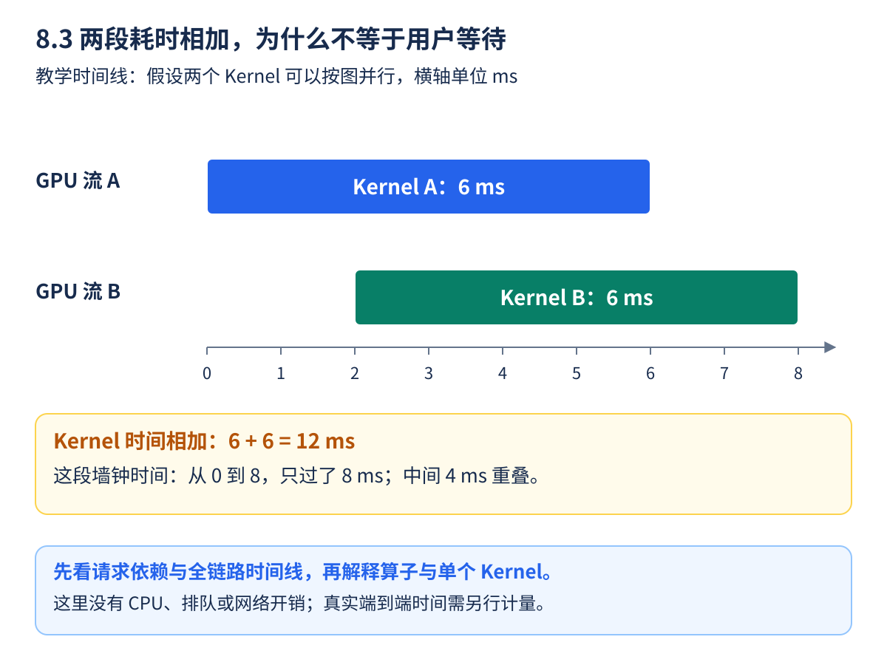
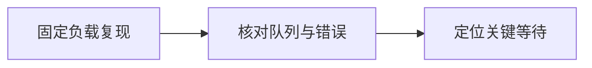
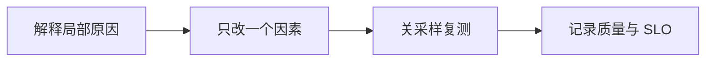

“请求变慢了”像“车开得慢”，原因可能是发动机、红灯，也可能是前面排队。Profiler 像行车记录仪，把时间花在哪里记录下来。**先判断在等什么，再选择要优化的部件**，比看到一个大算子就立即改 Kernel 更有效。

本节把 Profiling 当作隔离实验中的诊断手段。采样本身会增加开销，开启采样的结果不作为正常服务速度；完成定位后，还要关闭它重新压测。

<!-- more -->

## 📑 目录

- [1. 三种工具是一组逐层放大的镜头](#1-三种工具是一组逐层放大的镜头)
  - [1.1 先分清算子与 Kernel](#11-先分清算子与-kernel)
  - [1.2 CPU 调用时间不是 GPU 完成时间](#12-cpu-调用时间不是-gpu-完成时间)
  - [1.3 先看重叠，再决定时间能不能相加](#13-先看重叠再决定时间能不能相加)
- [2. 一个 CPU 也能运行的算子实验](#2-一个-cpu-也能运行的算子实验)
  - [2.1 给计算步骤起名字](#21-给计算步骤起名字)
  - [2.2 怎样读导出的时间线](#22-怎样读导出的时间线)
- [3. 把同样的方法用到 vLLM Worker](#3-把同样的方法用到-vllm-worker)
  - [3.1 采集服务端，不能只包住客户端](#31-采集服务端不能只包住客户端)
  - [3.2 在另一个终端只采一小段](#32-在另一个终端只采一小段)
- [4. Nsight Systems：沿着等待向前找原因](#4-nsight-systems沿着等待向前找原因)
  - [4.1 用有限离线任务先学时间线](#41-用有限离线任务先学时间线)
  - [4.2 空白区是线索，不是结论](#42-空白区是线索不是结论)
- [5. Nsight Compute：只对真正重要的内核下钻](#5-nsight-compute只对真正重要的内核下钻)
  - [5.1 从整条请求缩小到一个候选](#51-从整条请求缩小到一个候选)
  - [5.2 占用率与速度也不是一回事](#52-占用率与速度也不是一回事)
- [6. 从一份 Trace 写出可验证的解释](#6-从一份-trace-写出可验证的解释)
- [总结](#-总结)
- [自我检验清单](#-自我检验清单)
- [参考资料](#-参考资料)

---

## 1. 三种工具是一组逐层放大的镜头

| 工具 | 主要视角 | 先问的问题 |
|------|----------|------------|
| `torch.profiler` | PyTorch 算子、调用栈、形状及可选内存信息 | 哪类算子占时，输入形状是否变化 |
| Nsight Systems | CPU、CUDA、内核、通信的时间线 | GPU 在计算还是等待，进程之间怎样衔接 |
| Nsight Compute | 选定 GPU Kernel 的硬件计数与分析 | 这个内核受计算、带宽还是其他资源约束 |

### 1.1 先分清算子与 Kernel

算子是框架里的运算，例如矩阵乘法；Kernel 是实际提交到 GPU 的执行程序。一个算子可能发起多个 Kernel，多个算子也可能被融合为一个 Kernel。因此算子表和 GPU 内核表不必一行对应一行。

### 1.2 CPU 调用时间不是 GPU 完成时间

CUDA 操作通常异步提交：Python 调用返回时，GPU 可能还没算完。只在调用两边读 `perf_counter`，可能主要测到提交开销。隔离微基准需要适当同步或 CUDA Event；在线服务中却不能随意加入全局同步，以免改变并发行为。

“Self” 时间排除子调用，“Total” 时间包含子调用。把所有父子节点的 Total 相加会重复计数；多流并行的 Kernel 时间相加，也不等于请求墙钟时间。

### 1.3 先看重叠，再决定时间能不能相加



**沿横轴读图**：A 从 0 算到 6 ms，B 从 2 算到 8 ms，中间 4 ms 同时执行。单独问“两份工作各花多久”，答案都是 6 ms；问“从最早开始到最晚结束，钟表走了多久”，答案是 8 ms。把两份 6 ms 相加，会把重叠部分重复计算。

这里假设硬件与依赖允许图中的并行；并不是给任意两段 Kernel 放进不同 CUDA Stream，就保证它们能完全重叠。图也没有包含入口、CPU、排队和返回网络，所以这 8 ms 不是完整请求 E2E。真实时间线要先找依赖关系，再判断哪部分在用户必须等待的关键路径上。

父子调用则是另一种重复计数：若一个命名区域 Total 为 10 ms，里面的子调用占 8 ms，那么该区域 Self 可能为 2 ms。不能把父节点的 10 和子节点的 8 相加成 18。看表格之前，先问当前列统计的是“自己”“包含孩子”，还是“设备执行”。

**小练习**：一条请求共 100 ms，其中确定有 80 ms 无法被本次改动缩短，剩余计算由 20 减到 10 ms。总时长变成 90 ms，延迟下降 10%，不会因为这段计算快一倍，就让整条请求也快一倍。这个理想算例用于确定优化收益的范围。

## 2. 一个 CPU 也能运行的算子实验

### 2.1 给计算步骤起名字

在已有兼容 PyTorch 的环境中，将下方保存为 `profile_ops.py`。有 CUDA 时观察 GPU，没有 CUDA 时仍能学习 CPU 算子表：

```python
from pathlib import Path
import torch
from torch.profiler import profile, record_function, ProfilerActivity

torch.manual_seed(42)
torch.set_num_threads(1)
device = "cuda" if torch.cuda.is_available() else "cpu"
x = torch.randn(128, 128, device=device)
w = torch.randn(128, 128, device=device)
for _ in range(3):
    y = torch.relu(x @ w)
if device == "cuda":
    torch.cuda.synchronize()

activities = [ProfilerActivity.CPU]
if device == "cuda":
    activities.append(ProfilerActivity.CUDA)
with profile(activities=activities, record_shapes=True) as prof:
    for _ in range(4):
        with record_function("toy_projection"):
            y = x @ w
        with record_function("toy_activation"):
            y = torch.relu(y)
    if device == "cuda":
        torch.cuda.synchronize()

Path("results").mkdir(exist_ok=True)
prof.export_chrome_trace("results/operator-trace.json")
print("device:", device)
print(prof.key_averages().table(sort_by="self_cpu_time_total", row_limit=8))
assert tuple(y.shape) == (128, 128)
assert torch.isfinite(y).all().item()
```

第一次运行先关注形状、调用次数以及两个命名区域，而不是追求小矩阵的绝对毫秒。CPU 算子表不能证明真实模型的 GPU 瓶颈，断言也只验证这个教学计算的输出结构与有限值。

### 2.2 怎样读导出的时间线

使用支持 Chrome Trace 格式的查看器，例如 Perfetto。找到 `toy_projection` 和 `toy_activation`，展开框架算子；如果有 CUDA 活动，再看提交后 GPU 实际开始/结束的位置。

记录形状、栈和内存信息有额外成本。实际分析先选少量代表性请求，必要时再逐项加细节，不应一开始记录整个长时间生产流量。

可以先按下面三列读 `key_averages()` 表，而不必一次理解所有字段：

| 先看什么 | 在本例里怎样核对 | 读完还不能推出什么 |
|----------|------------------|----------------------|
| Name 与调用次数 | 找到两个 `toy_*` 命名区域，各执行四次 | 命名区域本身不等于一个 GPU Kernel |
| Self CPU 与 CPU Total | 区分包装、子算子和 CPU 上的执行/提交 | CPU Total 大，不代表对应 GPU 一直忙 |
| 形状与设备活动 | 核对矩阵是 128×128，并确认是否真的采到 CUDA | CPU 环境导出成功，不证明 GPU 轨道存在 |

本例表格按 Self CPU 时间排序，即使在 GPU 上运行，也不自动按 GPU 最慢内核排序。先看输出里的 `device`，再选择对应轨道和列；找不到 GPU 活动时，先确认运行环境与采集范围。

## 3. 把同样的方法用到 vLLM Worker

### 3.1 采集服务端，不能只包住客户端

在客户端用 `torch.profiler` 包住一个 HTTP 请求，主要看到客户端等待，不能自动看到远端 GPU。需要在实际执行模型的服务 Worker 开启采样。

vLLM v0.19.0 支持 `--profiler-config`。在隔离实验终端启动：

```bash
mkdir -p results/vllm-traces
CUDA_VISIBLE_DEVICES=0 vllm serve Qwen/Qwen3-0.6B \
  --served-model-name profile-demo --dtype half \
  --max-model-len 4096 --enforce-eager \
  --host 127.0.0.1 --port 8000 \
  --profiler-config '{"profiler":"torch","torch_profiler_dir":"./results/vllm-traces","torch_profiler_with_stack":false}'
```

与 8.2 的基线统一模型快照、长度和其他关键配置。此处省略的压测参数应按具体对照补齐，不能把两份不同配置的速度直接相减。

### 3.2 在另一个终端只采一小段

```bash
curl --fail -X POST http://127.0.0.1:8000/start_profile
curl --fail http://127.0.0.1:8000/v1/completions \
  -H 'Content-Type: application/json' \
  -d '{"model":"profile-demo","prompt":"Explain the role of a key value cache.","max_tokens":32,"temperature":0}'
curl --fail -X POST http://127.0.0.1:8000/stop_profile
```

正式采样前先预热，停止后等待文件写出。目录在服务端/容器内部，不会自动出现在客户端；停止采样可能因文件整理而耗时。参数与端点以目标 tag 为准，这些诊断端点也不应成为普通外部调用入口。

## 4. Nsight Systems：沿着等待向前找原因

### 4.1 用有限离线任务先学时间线

安装兼容 Nsight Systems 后，在隔离环境运行一个很短的任务：

```bash
mkdir -p results
VLLM_WORKER_MULTIPROC_METHOD=spawn nsys profile \
  --trace=cuda,nvtx,osrt --trace-fork-before-exec=true \
  --output results/latency-trace-r1 \
  vllm bench latency --model Qwen/Qwen3-0.6B \
    --dtype half --max-model-len 4096 --enforce-eager \
    --input-len 128 --output-len 8 --batch-size 1 \
    --num-iters-warmup 2 --num-iters 1
nsys stats results/latency-trace-r1.nsys-rep
```

此命令可能同时捕获加载和预热，读图时定位后面的实际生成区域，不把下载、加载或编译直接当作稳态 Decode。多进程、CUDA Graph 和平台版本影响采集方式，先确认所需 Worker 的轨道确实出现。

### 4.2 空白区是线索，不是结论

| 时间线现象 | 下一步核对 |
|------------|------------|
| GPU 长时间空白，CPU 忙 | Tokenization、组批、调度和提交是否跟得上 |
| CUDA 同步附近等待 | 在等上游数据、其他流还是通信 |
| 许多很短的 Kernel 间有间隙 | 提交开销、图优化或 CPU 供给 |
| 某 Rank 长等待其他 Rank | 负载、拓扑、通信与阶段不均 |
| 长 Prefill 进入后 ITL 拉长 | 对齐请求分组，检查 P/D 互扰 |

GPU 空白也可能来自未采到目标进程、活动被过滤或负载本来不足。先排除观察范围错误，再提出优化假设。

## 5. Nsight Compute：只对真正重要的内核下钻

### 5.1 从整条请求缩小到一个候选

先在 Systems 或算子表中确认某个 Kernel 对关键路径的贡献，再选择代表性的形状采集 Compute 数据。记录内核名称、输入规模和配置，比较计算吞吐、内存访问、占用率及相关限制。

```bash
ncu --help
```

实际过滤参数应按安装版本和已观察到的 Kernel 名称填写。随便采“第一个 Kernel”，很可能采到初始化而不是瓶颈；给所有模型内核开启重度分析，又可能产生大量重放和等待。

### 5.2 占用率与速度也不是一回事

占用率描述可驻留的线程/warp 等资源使用，不等于请求吞吐。某个内核提高占用率，可能同时增加访存或改变其他成本；必须回到完整工作负载复测。

Profiler 可能重放 Kernel、改变缓存状态或干扰并发，因此采样是诊断证据。最终速度应来自关闭重度采样、配置一致的正常 Benchmark。

## 6. 从一份 Trace 写出可验证的解释



先用完整时间线锁定等待或热点，再用 Profiler/Compute 解释局部原因，进入下一轮验证：



假设候选版本 TPOT 变慢，不应只说“矩阵乘法占了 60%”。应说明同一负载下哪段新增了时间，是 Kernel 本身更慢、调用更多，还是等待更长，并用前后时间线关联。百分比升高也可能只是其他部分变快，绝对时间更有解释力。

新手练习：运行 CPU 小实验，把矩阵维度从 128 改成 256，观察算子形状与时间。它训练的是读工具的方法，不是大模型 GPU 加速结论。

尝试用四句话记录一次诊断：“同样负载下什么指标变慢”“哪份原始记录显示变化发生在哪段”“我怀疑什么机制，准备只改哪个因素”“关闭采样后怎样验收”。如果第二句话还只能写“GPU 很忙”，就需要继续补证据，而不是急着给内核下结论。

## 📝 总结

- 算子表、全链路时间线、Kernel 计数器各有观察层次。
- 异步提交、子调用和并行会影响时间的解释，不能机械相加。
- 采样要短、范围要对，客户端等待不能代替服务端分析。
- 提出解释后关闭 Profiler 复测，让正确性和 SLO 决定优化是否有效。

## 🎯 自我检验清单

- 能区分 PyTorch 算子与 GPU Kernel
- 能解释 CPU 提交时间为什么不等于 GPU 完成时间
- 能运行 CPU 实验并找到命名区域和导出文件
- 能说明为何要采 vLLM Worker，而不是只采 HTTP 客户端
- 能从 Systems 的一个等待区提出下一步检查项
- 能说明 Compute 的局部结果为何必须回到端到端复测

## 📚 参考资料

- [PyTorch — torch.profiler](https://docs.pytorch.org/docs/stable/profiler.html)
- [vLLM v0.19.0 — Profiling](https://github.com/vllm-project/vllm/blob/v0.19.0/docs/contributing/profiling.md)
- [NVIDIA — Nsight Systems User Guide](https://docs.nvidia.com/nsight-systems/UserGuide/index.html)
- [NVIDIA — Nsight Compute Profiling Guide](https://docs.nvidia.com/nsight-compute/ProfilingGuide/index.html)

---

[返回本章](https://caomaolufei.github.io/AIInfraGuide/inference/模块四-推理优化/第8章-性能分析与benchmark/) · [上一节](https://caomaolufei.github.io/AIInfraGuide/inference/模块四-推理优化/第8章-性能分析与benchmark/82-压测工具与可复现实验/) · [下一节](https://caomaolufei.github.io/AIInfraGuide/inference/模块四-推理优化/第8章-性能分析与benchmark/84-权威基准与结果解读/)
