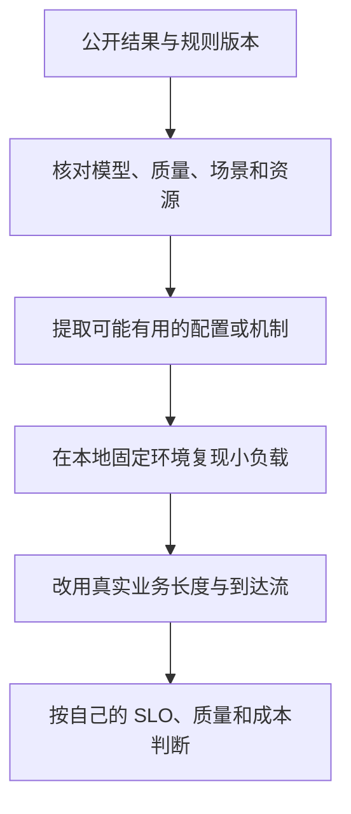

考试分数只有在科目、题目和规则一致时才方便比较。一个系统得 90 分，另一个写着“每秒 1000 Token”，并不能立即判断谁更好。**权威基准的价值首先在于共同规则，而不是提供一个脱离条件的神奇数字。**

本节教你阅读结果，不要求先搭建完整提交系统。基准任务、版本、质量门槛和场景会演进，实际评估必须保存所用规则版本或提交，不从旧教程推断当前所有要求。

<!-- more -->

## 📑 目录

- [1. 为什么要有共同的题目和规则](#1-为什么要有共同的题目和规则)
  - [1.1 自己压得很快，还缺什么](#11-自己压得很快还缺什么)
  - [1.2 正确性是性能成绩的前提](#12-正确性是性能成绩的前提)
- [2. MLPerf Inference：先理解场景，再看分数](#2-mlperf-inference先理解场景再看分数)
  - [2.1 Datacenter 中常见的两种问题](#21-datacenter-中常见的两种问题)
  - [2.2 谁生成负载，谁接受测试](#22-谁生成负载谁接受测试)
  - [2.3 Closed、Open 与成绩归属](#23-closedopen-与成绩归属)
- [3. 阅读一条结果，至少打开六个格子](#3-阅读一条结果至少打开六个格子)
  - [3.1 总性能与单位资源性能要分开](#31-总性能与单位资源性能要分开)
  - [3.2 功耗数字同样需要边界](#32-功耗数字同样需要边界)
- [4. LLMPerf 与生成式评测趋势](#4-llmperf-与生成式评测趋势)
  - [4.1 一个工具库不等于一套统一考试](#41-一个工具库不等于一套统一考试)
  - [4.2 为什么生成式模型越来越重视过程](#42-为什么生成式模型越来越重视过程)
  - [4.3 远端 API 的成绩还包含什么](#43-远端-api-的成绩还包含什么)
- [5. 从公开结果走到自己的验证](#5-从公开结果走到自己的验证)
  - [5.1 新手可以做的一次纸面审查](#51-新手可以做的一次纸面审查)
  - [5.2 基准用来缩小候选，不替代业务验收](#52-基准用来缩小候选不替代业务验收)
- [总结](#-总结)
- [自我检验清单](#-自我检验清单)
- [参考资料](#-参考资料)

---

## 1. 为什么要有共同的题目和规则

### 1.1 自己压得很快，还缺什么

8.2 的自定义压测能回答特定服务的问题，但其他人可能使用不同模型、输入长度、输出长度、精度和计时方式。哪怕都写 Token/s，也可能一边统计输入加输出，一边只统计输出。

共同基准会规定任务、数据、质量要求、负载和测量方法，让相同条件下的结果更可比较。它仍有边界：基准题不能覆盖所有业务文本、长对话、工具调用和失败处理。

### 1.2 正确性是性能成绩的前提

如果把回答截断为十个 Token，服务可能显得很快；若任务原本要求完整摘要，这不是同质量提速。类似地，更低精度、更短上下文、不同模板都可能改变质量与工作量。

所以比较顺序应是：先核对任务与质量，再看负载场景和资源，最后读性能。模型名字相同，也应进一步核对版本、精度、处理流程和允许的优化。

## 2. MLPerf Inference：先理解场景，再看分数

### 2.1 Datacenter 中常见的两种问题

MLPerf Inference 由 MLCommons 维护。以 Datacenter 中常见的 Offline 和 Server 为例：

| 场景 | 可以怎样理解 | 关注的测量问题 |
|------|--------------|----------------|
| Offline | 一批工作已经准备好 | 在规则约束下多快处理完 |
| Server | 请求按规定的到达过程进入 | 在延迟约束下能持续承受多大负载 |

不同任务还可能有 Interactive 等具体设置。不是每个模型都要求所有场景；应查看对应版本的任务表和生成式模型约束，而不是把这些名称视作任意任务都可互换的参数。

### 2.2 谁生成负载，谁接受测试

LoadGen 是基准中的负载生成与测量组件；SUT 是 System Under Test，即被测系统。二者的接口和计时约定是规则的一部分，不等于随便运行一次普通 HTTP 压测就完成了正式基准。

可以把 LoadGen 理解成出题与计时人员，SUT 是答题者。答题者可以内部组批、执行并行和优化内核，但还要遵守输入、输出、质量和场景要求。

### 2.3 Closed、Open 与成绩归属

不同提交分区对模型和允许改动有不同约束。阅读时必须核对 division、任务、场景、质量目标及测量配置；Open 里的探索不能不加说明地与 Closed 条件下的结果排成一个通用名次。

本节不是完整提交指南。准备正式成绩时，应依所选规则版本完成准确率、性能、合规检查和材料要求，并保留原始日志。自己的实验可以借鉴规则，但不能仅凭采用某个模型就自称通过正式认证。

## 3. 阅读一条结果，至少打开六个格子

| 结果卡 | 要寻找什么 | 为什么重要 |
|--------|------------|------------|
| 版本与任务 | 基准版本、模型、数据 | 不同试卷不可直接比较 |
| 质量与分区 | 精度/质量要求、division | 防止把不同质量当成等价 |
| 负载场景 | Offline、Server 等 | 峰值批量能力不等于在线体验 |
| 资源规模 | GPU 数/型号、节点、CPU/互联 | 更多硬件通常能提供更多总产出 |
| 软件配置 | 框架、精度、并行、优化 | 有助于复现和解释差异 |
| 分数定义 | 单位、延迟门槛、统计范围 | 防止混用请求/s 和 Token/s |

### 3.1 总性能与单位资源性能要分开

假设同任务、同口径、同质量下，A 用两张同类卡得到 400 输出 Token/s，B 用四张得到 600。B 总产出更高，但 A 的单位卡产出是 200，B 是 150。假设数字只用于算账，不能作为任何设备成绩。

也不能据此只凭单位卡数字选择 A：如果业务需要 500 Token/s 且不能拆分任务，A 的当前部署可能不满足需求。换成不同型号时，还需考虑价格、功耗和容量，单纯“每卡”也不够公平。

### 3.2 功耗数字同样需要边界

GPU 标称 TDP 不是整机实际推理能耗。CPU、内存、网络、空闲时间和测量窗口都会影响单位任务能耗。比较正式功耗结果要核对相应测量规则；自测则说明测的是板卡、整机还是更大的系统边界。

## 4. LLMPerf 与生成式评测趋势

### 4.1 一个工具库不等于一套统一考试

Ray 社区的 LLMPerf 是用于验证和评测 LLM 服务的开源工具库。它可以帮助构造请求并观察性能或正确性，但使用者仍要确定模型端点、长度、并发、任务和统计方法。

因此应区分“使用 LLMPerf 工具得到一组结果”与“满足某一版本 MLPerf 的完整提交规则”。两者都可能有价值，层次与可比较范围却不相同。

### 4.2 为什么生成式模型越来越重视过程

生成式请求不是只返回一个固定大小结果：有输入处理、首输出、后续迭代和结束。两个服务完成时间一样，其中一个先等很久才快速吐完，另一个匀速出字，用户感受不同。

这也是评测需要同时报告首字、出字、实际长度、质量、失败和负载的原因。推理链长度、工具调用、多模态输入或缓存复用会进一步改变工作量，不能只把“模型更大/更小”作为解释。

### 4.3 远端 API 的成绩还包含什么

远端服务结果通常包含网络、代理、服务商排队及配额影响。它能描述从某位置调用的体验，但不能自动推导出后端单卡的 Kernel 效率。要把“API 端到端比较”与“本地硬件测量”分开命名。

## 5. 从公开结果走到自己的验证

### 5.1 新手可以做的一次纸面审查

找两条公开结果，各写一张六格结果卡。如果模型、场景或单位不同，先标记为不能直接横比；若能对齐，再算单位资源产出，并说明仍缺什么条件。

不要为了给出一个排名而填补未知信息。无法确认 GPU 数、质量设置或结果窗口时，把未知项写出来，比用猜测得出“快两倍”更有学习价值。

### 5.2 基准用来缩小候选，不替代业务验收

候选在标准题上表现好，可以成为进一步试验的理由；是否适合自己的线上服务，还需用真实输入输出分布、目标 SLO、可用资源和失败策略验证。公开峰值不是对任意流量的服务承诺。

## 📝 总结

- 共同规则使性能有比较基础，质量是前提。
- MLPerf 的任务、场景、分区、版本与资源必须一起读。
- LLMPerf 等工具能帮助评测，但不会自动统一所有用户的实验条件。
- 总成绩、单位资源成绩和业务适用性是不同判断，最终要回到自己的服务目标。

## 🎯 自我检验清单

- 能解释 Offline 与 Server 为什么不能混成一个名次
- 能说明 LoadGen、SUT 和普通 HTTP 压测的关系
- 能为一条结果补齐六格条件卡
- 能手算两卡 400 与四卡 600 的单位卡产出
- 能区分标称 TDP 与实际测量能耗
- 能说明标准基准、工具库和业务验收各自解决什么问题

## 📚 参考资料

- [MLCommons — Inference Policies 与规则](https://github.com/mlcommons/inference_policies)
- [MLCommons — Inference Rules](https://github.com/mlcommons/inference_policies/blob/master/inference_rules.adoc)
- [MLCommons — Inference 与 LoadGen 实现](https://github.com/mlcommons/inference)
- [Ray — LLMPerf](https://github.com/ray-project/llmperf)

---

[返回本章](https://caomaolufei.github.io/AIInfraGuide/inference/模块四-推理优化/第8章-性能分析与benchmark/) · [上一节](https://caomaolufei.github.io/AIInfraGuide/inference/模块四-推理优化/第8章-性能分析与benchmark/83-性能分析工具与定位流程/) · [下一节](https://caomaolufei.github.io/AIInfraGuide/inference/模块四-推理优化/第8章-性能分析与benchmark/85-性能回归门禁与退化定位/)
