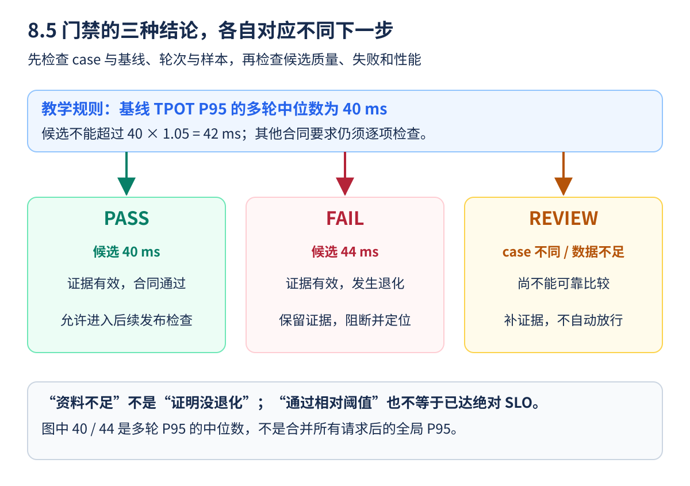
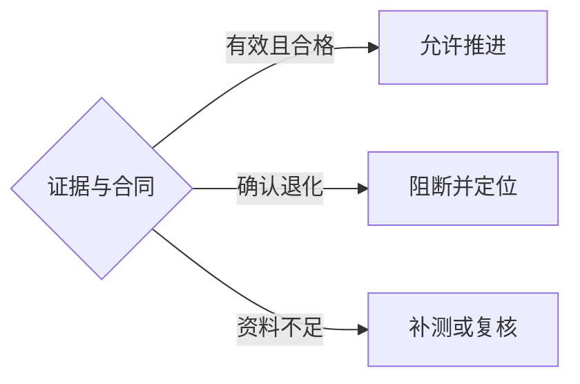

一次代码改动让单元测试全绿，却让用户的出字速度慢了。功能正确不代表性能没退化，性能门禁就是在发布前加一道检查：**同一道题、同一类资源，候选版本是否仍然满足质量和服务目标？**

门禁不是“遇到 5% 就机械拒绝”的数字游戏。要先知道基线可信、波动有多大，失败后能拿到什么证据。本节先用 CPU 可运行的教学比较器建立流程，再讨论真实 CI。

<!-- more -->

## 📑 目录

- [1. 先确定什么叫回归](#1-先确定什么叫回归)
  - [1.1 把业务目标写进测试合同](#11-把业务目标写进测试合同)
  - [1.2 哪些情况先判为证据不足](#12-哪些情况先判为证据不足)
- [2. 用多轮结果比较，不挑最好的一轮](#2-用多轮结果比较不挑最好的一轮)
  - [2.1 交替运行基线和候选](#21-交替运行基线和候选)
  - [2.2 同时保留绝对值和变化比例](#22-同时保留绝对值和变化比例)
  - [2.3 用红绿灯理解三种结论](#23-用红绿灯理解三种结论)
- [3. 一个可运行的教学比较器](#3-一个可运行的教学比较器)
  - [3.1 先规范化摘要，别猜工具字段](#31-先规范化摘要别猜工具字段)
  - [3.2 哪些事仍然需要真实系统完成](#32-哪些事仍然需要真实系统完成)
- [4. 把流程接到 CI，而不是把噪声接到 CI](#4-把流程接到-ci而不是把噪声接到-ci)
  - [4.1 CI 需要哪些工件](#41-ci-需要哪些工件)
  - [4.2 基线更新要能解释](#42-基线更新要能解释)
- [5. 回归出现后怎样定位](#5-回归出现后怎样定位)
  - [5.1 先排除工作量变化](#51-先排除工作量变化)
  - [5.2 git bisect 需要可靠的好坏判定](#52-git-bisect-需要可靠的好坏判定)
- [总结](#-总结)
- [自我检验清单](#-自我检验清单)
- [参考资料](#-参考资料)

---

## 1. 先确定什么叫回归

### 1.1 把业务目标写进测试合同

可以检查首字/出字尾延迟、目标 SLO 下 Goodput、失败、质量与显存容量。不同业务的必需项不同；例如离线批处理主要看总任务时间，流式聊天还需要关注暂停。

| 检查项 | 一条教学规则 | 为什么不能只留一项 |
|--------|--------------|----------------------|
| 质量 | 两版均通过固定任务集 | 防止通过截断或错误答案提速 |
| 失败 | 候选不新增失败 | 防止只统计剩余成功请求 |
| TPOT P95 | 候选不高于基线 1.05 倍 | 守住出字退化 |
| 输出吞吐 | 候选不低于基线 0.95 倍 | 防止延迟改善来自减少工作 |
| 方法 | 同一 case、足够轮次与请求 | 避免不同实验被硬比较 |

5% 是为了说明算法的例子，不是所有系统的通用阈值。真实门禁还要同时满足绝对 SLO；基线已经不达标时，候选“只慢了 1%”仍可能不适合发布。

### 1.2 哪些情况先判为证据不足

GPU 被其他任务占用、实际长度改变、Profiler 忘记关闭、基线过旧、样本太少或结果字段缺失，都不能直接证明代码性能变差。应标记 REVIEW/INCONCLUSIVE，补齐实验后再判断，不能自动当作通过。

## 2. 用多轮结果比较，不挑最好的一轮

### 2.1 交替运行基线和候选

例如按 A、B、A、B、A、B 顺序在受控设备上测量，记录温度、功耗状态、后台负载与缓存策略。这样能减少“前几轮与后几轮环境漂移”造成的误判，但仍需看波动和异常。

一轮 P95 来自该轮原始样本；取多轮 P95 的中位数用于轮次对照，不是整个集合的全局 P95。需要全局分位数时，应合并原始数据或兼容的直方图。

### 2.2 同时保留绝对值和变化比例

若基线 40 ms、候选 44 ms，变化为 $(44/40-1)\times100\%=10\%$。不要只写“多了 4”，忘记单位；也不要在基线为零或不可用时计算比例。

若每轮自然波动已经达到这个量级，应增加控制、样本与重复，而不是反复重跑直到偶然通过。对于高成本实验，可以先做便宜的快速筛查，再对候选执行完整门禁。

### 2.3 用红绿灯理解三种结论



先把**能不能比较**与**比较后有没有退化**分开。两版模型或长度不同、基线本身失败、样本不足时，像用两种试卷判定谁退步，第一步就不成立，应进入 REVIEW。证据可比较以后，再检查候选质量、失败、时间与吞吐；确认违反合同，才是 FAIL。

图中基线多轮 P95 的中位数为 40 ms，5% 教学阈值对应 42 ms。这个“中位数”是给多轮结果找中间位置，并非把所有请求重新合成了一个全局 P95。相同证据条件下，40 ms 可以过这一项，44 ms 不能过；实际结果还要同时通过代码中的其他检查。

**小练习**：候选恰好 42 ms，这项相对时间检查会失败吗？下方比较器使用 `>`，因此不会因这一项失败；若为 42.1 ms，就超过阈值。再问：业务绝对门槛为 35 ms 时，候选 40 ms 能上线吗？仍不满足业务要求。教学代码没有实现这条绝对 SLO 检查，接入真实门禁时必须补齐契约，不能把 PASS 当成完整上线批准。

## 3. 一个可运行的教学比较器

### 3.1 先规范化摘要，别猜工具字段

下方保存为 `gate_demo.py`。它接受**规范化后的自定义摘要**，不是直接把任意 vLLM JSON 丢进去。真实适配器要从原始记录计算长度、失败、质量、分位数和吞吐，并验证版本字段。

`case_id` 应代表模型 revision、工作负载、资源和测量口径等固定条件；被比较的代码提交可以不同。若有意比较参数变化，应建立清楚命名的实验组，而不是伪装成同条件 CI。

```python
import json
import math
import sys
from pathlib import Path
from statistics import median

def assess(base, candidate):
    if not base.get("case_id") or base.get("case_id") != candidate.get("case_id"):
        return {"status": "REVIEW", "reason": "实验身份不一致"}
    for summary in (base, candidate):
        runs = summary.get("runs", [])
        if len(runs) < 3:
            return {"status": "REVIEW", "reason": "轮次不足"}
        for run in runs:
            if not isinstance(run.get("quality_ok"), bool):
                return {"status": "REVIEW", "reason": "质量标签格式错误"}
            values = [run["tpot_p95_ms"], run["output_tokens_s"]]
            if run["requests"] < 1000 or not all(math.isfinite(v) and v > 0 for v in values):
                return {"status": "REVIEW", "reason": "样本或有效数值不足"}
            if not 0 <= run["failed"] <= run["requests"]:
                return {"status": "REVIEW", "reason": "失败计数非法"}
    if any(not r["quality_ok"] or r["failed"] for r in base["runs"]):
        return {"status": "REVIEW", "reason": "基线不合格"}
    if any(not r["quality_ok"] or r["failed"] for r in candidate["runs"]):
        return {"status": "FAIL", "reason": "候选质量或失败检查未通过"}
    b_latency = median(r["tpot_p95_ms"] for r in base["runs"])
    c_latency = median(r["tpot_p95_ms"] for r in candidate["runs"])
    b_rate = median(r["output_tokens_s"] for r in base["runs"])
    c_rate = median(r["output_tokens_s"] for r in candidate["runs"])
    reasons = []
    if c_latency > b_latency * 1.05:
        reasons.append("TPOT 退化超过教学阈值")
    if c_rate < b_rate * 0.95:
        reasons.append("输出吞吐下降超过教学阈值")
    return {"status": "FAIL" if reasons else "PASS", "reason": reasons}

def demo_summary(latencies, throughput):
    return {"case_id": "toy-fixed-case", "runs": [
        {"requests": 1000, "failed": 0, "quality_ok": True,
         "tpot_p95_ms": value, "output_tokens_s": throughput}
        for value in latencies]}

if len(sys.argv) == 3:
    base = json.loads(Path(sys.argv[1]).read_text(encoding="utf-8"))
    candidate = json.loads(Path(sys.argv[2]).read_text(encoding="utf-8"))
    result = assess(base, candidate)
    print(json.dumps(result, ensure_ascii=False))
    raise SystemExit({"PASS": 0, "FAIL": 1, "REVIEW": 2}[result["status"]])
elif len(sys.argv) == 1:
    # 人工摘要只演示判断逻辑，不代表实际执行过这些请求。
    base = demo_summary([39, 40, 41], 200)
    same = demo_summary([40, 40, 41], 200)
    slower = demo_summary([44, 45, 44], 200)
    assert assess(base, same)["status"] == "PASS"
    assert assess(base, slower)["status"] == "FAIL"
    assert assess(base, {"case_id": "other"})["status"] == "REVIEW"
    print("教学自检通过；退化案例：", assess(base, slower))
else:
    raise SystemExit("用法：python gate_demo.py [baseline-summary.json candidate-summary.json]")
```

不传文件时运行教学自检；传入两份按该 schema 生成的 JSON 时才按退出码执行门禁：

```bash
python gate_demo.py
# 接入真实实验后，先由适配器产生以下两份规范化摘要，再执行：
# python gate_demo.py baseline-summary.json candidate-summary.json
```

### 3.2 哪些事仍然需要真实系统完成

代码检查不了“声称 1000 条”是否真的来自有效原始样本，也没有置信区间、绝对 SLO 或全任务质量实现。真实流水线必须验证数据来源、失败/拒绝、时长与测量契约；教学数量限制仅用于防止最明显的误用，不是统计充分性的证明。

缺字段会报错并非零退出，不能吞掉异常后默认为通过。REVIEW 需要补证据；FAIL 需要诊断，两者都不是直接忽略门禁的理由。

可以把代码里的三层输入这样理解：原始记录像每位考生的答卷，规范化摘要像统一格式的成绩单，`assess` 像按规则检查成绩单。成绩单上写了“1000 条”，并不能代替答卷真的存在；同样，程序输出 PASS 只说明输入摘要通过了已实现的规则，不证明生成这些摘要的过程可靠。

退出码是给流水线读取的整数：本例 0 表示 PASS、1 表示 FAIL、2 表示 REVIEW。不要在 Shell 后面随意加 `|| true` 把失败改成成功；如果要把这段逻辑接入 CI，先分别用三种教学输入确认流水线确实执行了三种不同处理。

## 4. 把流程接到 CI，而不是把噪声接到 CI


上面四步产生证据，下面再按合同处理结果。质量、失败、绝对 SLO 与相对退化都属于相应检查，不能只看时间比例：



### 4.1 CI 需要哪些工件

保存基线/候选提交、容器和模型 revision、完整命令、负载文件哈希、设备记录、原始 JSON、规范化摘要以及比较报告。Trace 可在诊断重跑中另存，正常成绩不要在重度采样下取得。

GPU 执行器需要足够资源并避免并行任务互相争用。没有合适设备时应显式标记未执行，不能把 CPU 逻辑自检当作 GPU 性能门禁。耗时门禁也可以人工触发或按计划执行，但其运行与结论要能追溯。

### 4.2 基线更新要能解释

修正测试方法、模型升级或硬件变化后，应重新建立基线并保留旧记录。不能只因为候选失败，就把失败版本直接设为新基线；否则门禁会随着每次退化悄悄放宽。

## 5. 回归出现后怎样定位

### 5.1 先排除工作量变化

先查真实长度、EOS、缓存、样本量、失败、编译和设备竞争。若同模型改了模板，或重算次数增多，可能并非原来的 Kernel 突然变慢。

确认稳定复现后，再用 8.3 的短窗口时间线比较：新增了哪些调用、哪些算子绝对耗时变长、哪个阶段等待更多。用相同采样设置比较，最后关闭采样复测修复。

### 5.2 git bisect 需要可靠的好坏判定

`git bisect` 在已知好提交与坏提交之间二分缩小范围，每一步运行同一检查。环境不兼容或证据不足的提交应跳过或人工处理；自动 `bisect run` 的退出码约定与普通 CI 不完全相同，125 表示跳过，不能把教学比较器的 REVIEW=2 原样解释为跳过。

噪声很大的测试会把二分方向带偏。先让问题可重复，再二分；找到提交后仍要检查具体机制，而不是把相关性当作完整解释。

## 📝 总结

- 性能门禁先固定质量、资源、负载与计时合同，再比较候选。
- 多轮波动、证据不足和真正退化需要不同处理。
- 原始记录与规范化摘要都是证据，不能只保留一个退出码。
- CI、Profiler 和 bisect 串起复现、比较、定位与修复复测。

## 🎯 自我检验清单

- 能手算 40 ms 到 44 ms 的退化比例
- 能运行教学比较器并区分 PASS、FAIL、REVIEW
- 能解释规范化摘要为什么不能直接等同于任意工具原始 JSON
- 能说明样本量门槛为什么不自动证明统计可靠
- 能列出 CI 必须留存的配置和工件
- 能解释为何 bisect 之前应先得到稳定的好坏判定

## 📚 参考资料

- [vLLM v0.19.0 — Benchmark Serve 原始结果与指标](https://github.com/vllm-project/vllm/blob/v0.19.0/vllm/benchmarks/serve.py)
- [vLLM v0.19.0 — Profiling](https://github.com/vllm-project/vllm/blob/v0.19.0/docs/contributing/profiling.md)
- [Git — git bisect 与退出码约定](https://git-scm.com/docs/git-bisect)

---

[返回本章](https://caomaolufei.github.io/AIInfraGuide/inference/模块四-推理优化/第8章-性能分析与benchmark/) · [上一节](https://caomaolufei.github.io/AIInfraGuide/inference/模块四-推理优化/第8章-性能分析与benchmark/84-权威基准与结果解读/) · [下一节](https://caomaolufei.github.io/AIInfraGuide/inference/模块四-推理优化/第9章-生产部署与运维/91-容器化与kubernetes部署/)
