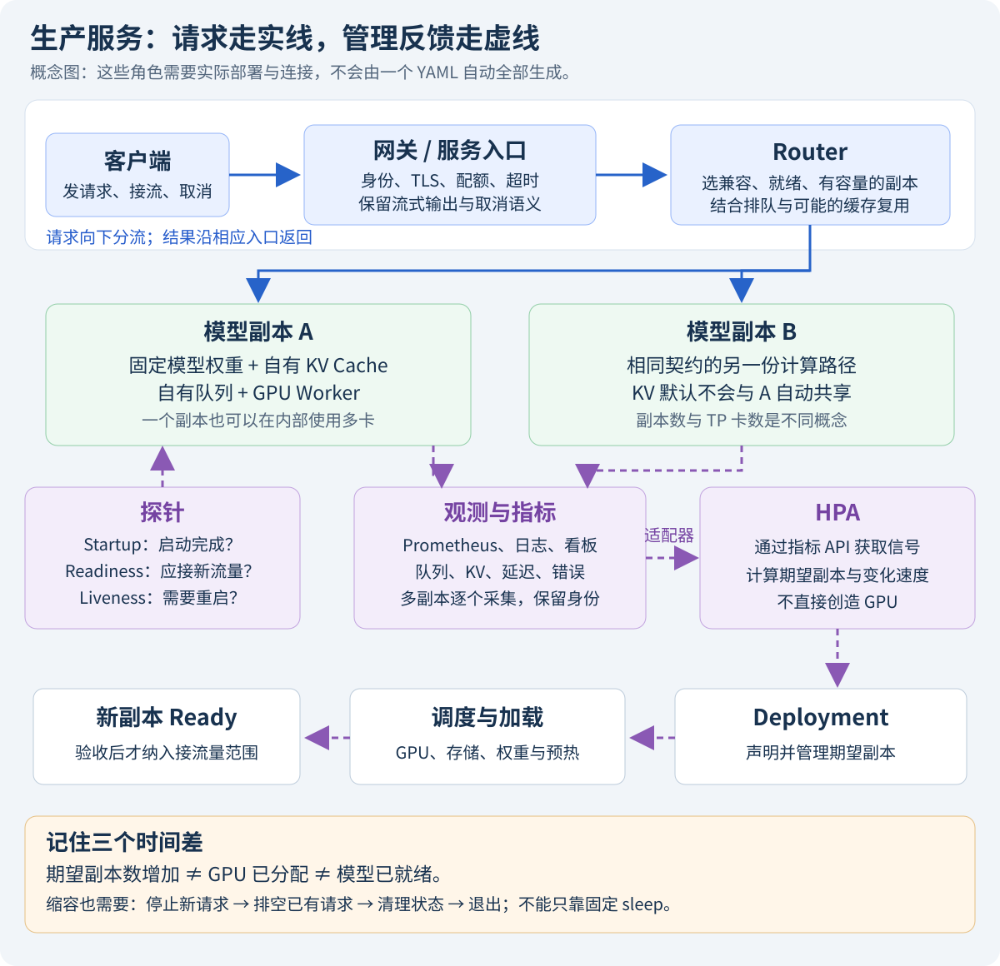

在自己的终端里跑通一次生成，像在家里做好一顿饭；持续给很多人供餐，还需要固定配方、工位安排、健康检查和换班流程。容器固定运行环境，Kubernetes 安排进程与资源，而模型服务是否真的能回答，仍需要我们验收。

本节以 **vLLM v0.19.0、单 GPU、一个普通 Dense 副本**为学习起点。示例是实验部署，不自动补齐网关、认证、监控和扩容；后面三节会把这些连起来。

<!-- more -->

## 📑 目录

- [1. 先认识部署中反复出现的对象](#1-先认识部署中反复出现的对象)
  - [1.1 镜像相同，模型也未必相同](#11-镜像相同模型也未必相同)
  - [1.2 从外部请求看部署全景](#12-从外部请求看部署全景)
- [2. 先在一台 GPU 主机上验证容器](#2-先在一台-gpu-主机上验证容器)
  - [2.1 固定快照，并确认容器确实看到 GPU](#21-固定快照并确认容器确实看到-gpu)
  - [2.2 逐项读端口、挂载与显存配置](#22-逐项读端口挂载与显存配置)
- [3. 把同一个副本放进 Kubernetes](#3-把同一个副本放进-kubernetes)
  - [3.1 GPU 与存储的前置条件](#31-gpu-与存储的前置条件)
  - [3.2 一份完整的单副本实验清单](#32-一份完整的单副本实验清单)
  - [3.3 三类探针解决不同阶段的问题](#33-三类探针解决不同阶段的问题)
- [4. 按层验收，而不是只等 Pod 变绿](#4-按层验收而不是只等-pod-变绿)
  - [4.1 在自己的实验集群执行](#41-在自己的实验集群执行)
  - [4.2 用端口转发验证真实生成](#42-用端口转发验证真实生成)
- [5. 更新、模型存储与多卡时的新问题](#5-更新模型存储与多卡时的新问题)
  - [5.1 滚动更新也需要额外工位](#51-滚动更新也需要额外工位)
  - [5.2 多副本与多卡副本不能混淆](#52-多副本与多卡副本不能混淆)
- [6. Production Stack、KServe 与原生清单](#6-production-stackkserve-与原生清单)
- [总结](#-总结)
- [自我检验清单](#-自我检验清单)
- [参考资料](#-参考资料)

---

## 1. 先认识部署中反复出现的对象

| 对象 | 通俗含义 | 本例对应 |
|------|----------|----------|
| 镜像 Image | 带软件与启动约定的打包环境 | vLLM 镜像，不一定内置模型权重 |
| 容器 Container | 镜像启动后的一份运行实例 | 正在跑的 vLLM 进程环境 |
| Pod | Kubernetes 调度和运行的基本单位 | 本例一个服务容器和它的卷 |
| Deployment | 管理副本和版本更新的控制器 | 希望一直有指定数量副本 |
| Service | 给一组匹配 Pod 提供稳定服务入口 | `vllm-demo:8000` |
| PVC | 对持久存储的一份申请 | 已准备好的模型快照存储 |
| Namespace | 集群里划分命名与管理范围的空间 | Deployment、Service 和 PVC 需要处在对应范围 |
| GPU 资源 | 调度器可分配的设备额度 | 本例申请 `nvidia.com/gpu: 1` |

### 1.1 镜像相同，模型也未必相同

同一镜像可以加载不同模型；同一模型仓库名也可能在不同时间指向不同 revision。因此软件镜像和模型快照是两份身份信息，都要记录。

镜像标签便于人读，digest 更适合固定内容。示例用版本标签表达基线，复现时还应记录实际拉取的 digest、GPU 架构兼容性和模型文件来源。

### 1.2 从外部请求看部署全景



实线表示用户请求主路径，虚线表示探针、监控和调度反馈。图中的网关、Router、监控不是仅写一个 Deployment 就会自动全部出现的组件；后面会逐项建立。

## 2. 先在一台 GPU 主机上验证容器

### 2.1 固定快照，并确认容器确实看到 GPU

需要已配置 GPU 的 Linux 容器环境与对应 NVIDIA 容器支持。宿主 `nvidia-smi` 正常，只能证明宿主可见；容器能否访问设备，还要看实际运行环境。

假设已把固定 revision 的 `Qwen/Qwen3-0.6B` 快照放在宿主目录 `/srv/models/qwen3-0.6b`。这里是待准备的路径，不会由命令自动创建或下载：

```bash
MODEL_DIR=/srv/models/qwen3-0.6b
docker run --rm --name vllm-demo --gpus device=0 --shm-size=1g \
  -p 127.0.0.1:8000:8000 \
  --mount "type=bind,src=${MODEL_DIR},dst=/models/demo,readonly" \
  --entrypoint vllm vllm/vllm-openai:v0.19.0 \
  serve /models/demo --served-model-name infra-demo \
  --dtype half --max-model-len 4096 --gpu-memory-utilization 0.85 \
  --host 0.0.0.0 --port 8000
```

### 2.2 逐项读端口、挂载与显存配置

`--gpus device=0` 选择设备，不是自动 TP；只读挂载把模型暴露到容器里的 `/models/demo`；`--shm-size` 设置共享内存空间，不等于 GPU 显存。

容器内部监听 `0.0.0.0`，宿主发布到 `127.0.0.1`，便于本机实验访问。容器内的 loopback 与宿主不是同一个网络位置，不能把这两个地址混为一谈。

另一终端按 8.2 的请求格式访问本机 8000，模型名改为 `infra-demo`。先检查健康、真实生成和结束原因，再增加负载。小模型用于学习链路，不代表任意模型都能装入一张 GPU。

## 3. 把同一个副本放进 Kubernetes

### 3.1 GPU 与存储的前置条件

集群需要有可分配 NVIDIA GPU 的节点、相应设备插件/容器运行环境，以及足够的 CPU/内存。GPU 不是普通 CPU 资源，调度器不会因为写了资源名就创造设备。

以下清单假设当前 namespace 已有 **Bound 的 PVC `model-store`**，其中 `qwen3-0.6b` 子目录是固定模型快照。PVC 怎样创建、StorageClass 和访问模式是什么，依环境决定；没有该 PVC 时 Pod 会等待，不能直接进入模型性能排错。

### 3.2 一份完整的单副本实验清单

保存为 `vllm-demo.yaml`。请求两核 CPU、8 GiB 内存及一张 GPU，数值是实验起点，需按实际加载峰值调整：

```yaml
apiVersion: apps/v1
kind: Deployment
metadata:
  name: vllm-demo
spec:
  replicas: 1
  strategy:
    type: RollingUpdate
    rollingUpdate:
      maxSurge: 1
      maxUnavailable: 0
  selector:
    matchLabels:
      app: vllm-demo
  template:
    metadata:
      labels:
        app: vllm-demo
    spec:
      terminationGracePeriodSeconds: 180
      containers:
        - name: engine
          image: vllm/vllm-openai:v0.19.0
          command: ["vllm", "serve"]
          args:
            - /models/qwen3-0.6b
            - --served-model-name
            - infra-demo
            - --dtype
            - half
            - --max-model-len
            - "4096"
            - --gpu-memory-utilization
            - "0.85"
            - --host
            - "0.0.0.0"
            - --port
            - "8000"
          ports:
            - name: http
              containerPort: 8000
          resources:
            requests:
              cpu: "2"
              memory: 8Gi
              nvidia.com/gpu: 1
            limits:
              cpu: "4"
              memory: 16Gi
              nvidia.com/gpu: 1
          volumeMounts:
            - name: model
              mountPath: /models
              readOnly: true
            - name: shm
              mountPath: /dev/shm
          startupProbe:
            httpGet:
              path: /health
              port: http
            periodSeconds: 10
            failureThreshold: 180
          readinessProbe:
            httpGet:
              path: /health
              port: http
            periodSeconds: 5
            failureThreshold: 3
          livenessProbe:
            httpGet:
              path: /health
              port: http
            periodSeconds: 10
            failureThreshold: 3
      volumes:
        - name: model
          persistentVolumeClaim:
            claimName: model-store
        - name: shm
          emptyDir:
            medium: Memory
            sizeLimit: 1Gi
---
apiVersion: v1
kind: Service
metadata:
  name: vllm-demo
spec:
  type: ClusterIP
  selector:
    app: vllm-demo
  ports:
    - name: http
      port: 8000
      targetPort: http
```

GPU requests 与 limits 相同。CPU/内存的 request 帮助调度，limit 则限制使用；主机内存超限与 GPU OOM 是不同问题。内存型 `emptyDir` 使用主机内存，需计入容量预算。

### 3.3 三类探针解决不同阶段的问题

| 探针 | 问的问题 | 失败后的主要作用 |
|------|----------|------------------|
| Startup | 模型是否完成漫长启动 | 未成功前暂缓其他探针；超过失败阈值会重启 |
| Readiness | 现在是否应接新流量 | 影响就绪与服务流量选择，不直接以此重启容器 |
| Liveness | 进程是否需要重启恢复 | 持续失败后触发重启 |

这里启动预算约为 180×10 秒，是假设上限，不是保证半小时内可加载任意模型。应根据真实冷启动、存储和编译情况设置。不能用很短的存活阈值反复杀死正在正常加载的服务。

同用 `/health` 是基础示例，并不检测业务质量或 SLO。若要根据容量决定准入，应设计相应控制，不应把一次请求变慢就直接判定进程必须重启。

## 4. 按层验收，而不是只等 Pod 变绿

### 4.1 在自己的实验集群执行

先确认当前 context 和 namespace。下面操作会在所选集群创建实验 Deployment 和 Service，本文不替你执行：

```bash
kubectl config current-context
kubectl apply --dry-run=client -f vllm-demo.yaml
kubectl apply -f vllm-demo.yaml
kubectl get pods -l app=vllm-demo
kubectl logs -l app=vllm-demo --tail=100
kubectl rollout status deployment/vllm-demo
```

Client dry-run 不证明 GPU 存在、PVC 已绑定、API 服务支持所有字段或模型能运行。需要服务器侧和运行时验收；后面的状态和日志才会逐步提供这些证据。

### 4.2 用端口转发验证真实生成

```bash
kubectl port-forward service/vllm-demo 8000:8000 --address 127.0.0.1
```

该终端保持运行，另一终端使用 `curl` 访问本机 8000，按 `infra-demo` 发送短生成请求。端口转发是实验通道，不是正式公网入口，也不代表已经测试多副本的真实路由效果。

| 状态或现象 | 优先检查 |
|------------|----------|
| Pending | GPU/CPU/内存不足、PVC、节点与配额约束 |
| 镜像拉取失败 | 镜像名、架构、凭据、网络 |
| 反复重启 | 容器日志、主机/GPU OOM、探针预算 |
| Ready 但请求失败 | 模型别名、模板、上下文与执行错误 |
| 生成正确但慢 | 用第八章的固定负载检查队列、KV 和瓶颈 |

## 5. 更新、模型存储与多卡时的新问题

### 5.1 滚动更新也需要额外工位

本例 `maxSurge=1,maxUnavailable=0` 希望新副本先就绪，再替换旧副本。若只有一张可用 GPU，新 Pod 可能一直 Pending，因为旧 Pod 仍在占卡。要提前留发布余量，或明确接受不同更新策略带来的容量下降。

模型卷访问模式同样可能限制跨节点并发挂载。只写 replicas=2，不保证两份 Pod 都能读到存储。镜像、快照、存储吞吐和预热共同决定何时真正可接流量。

### 5.2 多副本与多卡副本不能混淆

replicas=4 通常是四份服务副本；在一个 Pod 里申请四张 GPU，不会自动形成 TP=4，仍需模型并行参数和兼容执行器。一个 Pod 的 GPU 申请也不会自动拆到四个节点。

跨节点模型并行还要处理分组调度、地址、通信、放置与故障。先按第六章跑通相应模型并行，再接入容器编排，不应只扩大 YAML 数字。

## 6. Production Stack、KServe 与原生清单

| 方案 | 可以提供的层次 | 仍需自己验证 |
|------|----------------|--------------|
| 原生 Deployment/Service | 基础进程、副本与网络入口 | 路由、指标、发布、扩容与运维连接 |
| vLLM Production Stack | 面向 vLLM 的 Kubernetes 部署与集群组件 | 所选版本的 Router、指标、资源和配置 |
| KServe | 推理服务资源与运行时管理等平台能力 | 具体 runtime、安装模式和生成式服务能力 |

这些是不同封装层次，不是安装后自动获得最佳参数。先画清楚请求、控制面和观测路径，再按目标版本的文档集成；不要把不同项目的 Helm values、CRD 与普通 Deployment 字段混写。

新手练习可以先做到“固定快照 → 单副本 Ready → 一条正确生成 → 记录启动耗时”。9.2 加入观测，9.3 再处理流量、认证与扩缩容。

## 📝 总结

- 镜像、模型、Pod、副本和 GPU 是不同对象，都需要清晰身份与资源约束。
- Startup、Readiness、Liveness 分别管理启动、接流量和重启判断。
- Pod 正常只是一层证据，还要验收真实生成、容量和版本更新。
- 框架可以提供编排能力，存储、通信、冷启动和发布余量仍要实测。

## 🎯 自我检验清单

- 能解释为什么镜像固定还需要固定模型 revision
- 能读懂宿主端口、容器端口、挂载目录和 Service
- 能区分主机内存限制、GPU 额度与实际显存需求
- 能说明三类探针各自失败会发生什么
- 能定位 Pending、拉取失败和模型加载失败属于哪一层
- 能解释只有一张空闲 GPU 时滚动更新为什么可能卡住
- 能区分四副本、单机 TP=4 和跨机四卡部署

## 📚 参考资料

- [vLLM v0.19.0 — Kubernetes Deployment](https://github.com/vllm-project/vllm/blob/v0.19.0/docs/deployment/k8s.md)
- [Kubernetes — Schedule GPUs](https://kubernetes.io/docs/tasks/manage-gpus/scheduling-gpus/)
- [Kubernetes — Startup、Readiness 与 Liveness Probes](https://kubernetes.io/docs/concepts/workloads/pods/probes/)
- [vLLM — Production Stack](https://github.com/vllm-project/production-stack)
- [KServe — Generative Inference Runtime Overview](https://kserve.github.io/website/docs/model-serving/generative-inference/overview)

---

[返回本章](https://caomaolufei.github.io/AIInfraGuide/inference/模块四-推理优化/第9章-生产部署与运维/) · [上一节](https://caomaolufei.github.io/AIInfraGuide/inference/模块四-推理优化/第8章-性能分析与benchmark/85-性能回归门禁与退化定位/) · [下一节](https://caomaolufei.github.io/AIInfraGuide/inference/模块四-推理优化/第9章-生产部署与运维/92-可观测性与告警/)
