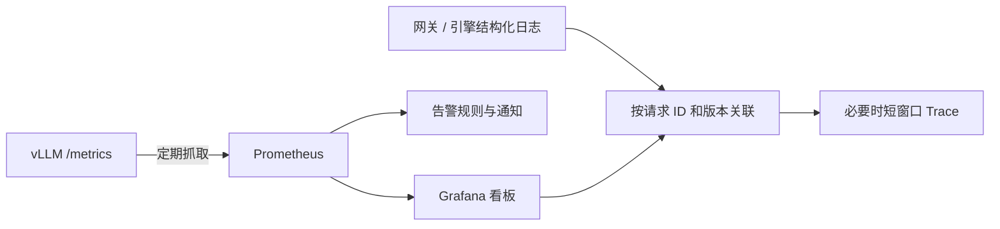

用户说“今天回答很慢”，仅看一个 GPU 利用率数字很难解释。可观测性的目标，是把体验、请求、队列、缓存、设备和版本连接起来，让人能从现象找到证据。

可以把指标看成体温表，日志看成事件记录，Trace 看成一次请求经过各环节的行程。它们互相补充：**指标帮你发现范围，关联记录帮你查具体原因。**

<!-- more -->

## 📑 目录

- [1. 先建立最短的观测链路](#1-先建立最短的观测链路)
  - [1.1 先看真实暴露的指标](#11-先看真实暴露的指标)
  - [1.2 单副本可以先用静态抓取](#12-单副本可以先用静态抓取)
- [2. 三类指标，三种不同读法](#2-三类指标三种不同读法)
  - [2.1 Counter 不直接当每秒速率](#21-counter-不直接当每秒速率)
  - [2.2 Gauge 需要知道分母](#22-gauge-需要知道分母)
  - [2.3 Histogram 的 bucket 是累计桶](#23-histogram-的-bucket-是累计桶)
- [3. 本版 vLLM 的指标地图](#3-本版-vllm-的指标地图)
  - [3.1 用源码与实际端点双重确认](#31-用源码与实际端点双重确认)
  - [3.2 引擎与网关各自看得见什么](#32-引擎与网关各自看得见什么)
- [4. 三条能解释的 PromQL](#4-三条能解释的-promql)
  - [4.1 看单位时间真正生成多少输出](#41-看单位时间真正生成多少输出)
  - [4.2 聚合兼容桶后估计首字 P95](#42-聚合兼容桶后估计首字-p95)
  - [4.3 查看哪些副本在排队](#43-查看哪些副本在排队)
- [5. Grafana 看板与日志怎样连起来](#5-grafana-看板与日志怎样连起来)
  - [5.1 看板按照排查顺序组织](#51-看板按照排查顺序组织)
  - [5.2 请求 ID 放日志，不放每条指标标签](#52-请求-id-放日志不放每条指标标签)
- [6. 告警需要有持续条件和处理动作](#6-告警需要有持续条件和处理动作)
  - [6.1 一份教学规则](#61-一份教学规则)
  - [6.2 给告警配一张操作卡](#62-给告警配一张操作卡)
- [总结](#-总结)
- [自我检验清单](#-自我检验清单)
- [参考资料](#-参考资料)

---

## 1. 先建立最短的观测链路



### 1.1 先看真实暴露的指标

在本机服务或 9.1 的端口转发通道中运行：

```bash
curl --fail http://127.0.0.1:8000/metrics -o metrics-sample.txt
```

查看 `HELP`、`TYPE`、名称、单位与 labels，而不只是复制网上的查询。本文以 vLLM v0.19.0 V1 指标源码为基线；旧教程与其他版本可能改名或隐藏指标。

### 1.2 单副本可以先用静态抓取

以下片段放进已有 Prometheus 配置，假设 Prometheus 与 9.1 的 Service 位于同一 namespace、网络可达：

```yaml
scrape_configs:
  - job_name: vllm
    metrics_path: /metrics
    scrape_interval: 15s
    static_configs:
      - targets: ["vllm-demo:8000"]
```

这只是**单副本教学入口**，不会安装 Prometheus。多副本时应通过 Pod/Endpoint 服务发现逐个抓取，保留副本身份；若只反复抓一个负载均衡 Service 地址，可能每次命中不同副本，造成漏采和计数跳动。

`localhost` 总指抓取进程自己的环境。如果 Prometheus 跑在另一个容器或 Pod，不能把你的终端 `localhost:8000` 直接当成它的目标地址。

## 2. 三类指标，三种不同读法

| 类型 | 像什么 | 合适的读法 |
|------|--------|------------|
| Counter | 累计里程表 | 看一段时间的增长速率，并处理进程重启 |
| Gauge | 当前水位 | 看当前值、趋势和热点 |
| Histogram | 按范围分桶的成绩分布 | 聚合兼容桶后估计分位数或平均值 |

### 2.1 Counter 不直接当每秒速率

如果输出 Token 累计数在无重启的 60 秒内从 600 增加到 900，简单窗口平均为 5 Token/s；累计值 900 本身不是吞吐。

实际 Prometheus 使用 `rate` 等函数处理区间与重启。跨副本通常先对每条 Counter 求 rate，再汇总；把计数器混成一条后才算，容易受某一副本重置影响。

### 2.2 Gauge 需要知道分母

`vllm:kv_cache_usage_perc` 在本版里 1 表示 100%，0.85 表示 85%，名称里的 perc 不能直接推断为 0～100。它描述缓存池使用，不是整张 GPU 显存百分比。

Running 是模型执行批次中的请求，Waiting 是等待处理的请求。一个 Running 请求并不独占 GPU，同样四条请求也可能有完全不同的上下文和计算成本。

### 2.3 Histogram 的 bucket 是累计桶

经典直方图的 `le` 表示“小于等于某个上界”，桶计数是累计的，不是每个区间独立计数。`_sum` 是观测值总和，`_count` 是观测数，`_bucket` 支持按桶估算分位数。

P95 是估计值，精度受桶边界影响；不要在没有请求时把空分布解释为零延迟，也不要平均各 Pod 的 P95 当成集群 P95。

## 3. 本版 vLLM 的指标地图

| 目的 | 指标或暴露序列示例 | 解释边界 |
|------|--------------------|----------|
| 执行与排队 | `vllm:num_requests_running`、`vllm:num_requests_waiting` | 队列数量不是剩余毫秒 |
| KV 水位 | `vllm:kv_cache_usage_perc` | 缓存池比例，不是整个显存 |
| 抢占 | `vllm:num_preemptions_total` | Counter，看增长而非只看总数 |
| 输出工作 | `vllm:generation_tokens_total` | 输出 Token，不含输入 |
| 首字 | `vllm:time_to_first_token_seconds` | 直方图，服务端计时范围与客户端未必相同 |
| 逐步间隔 | `vllm:inter_token_latency_seconds` | 与每请求平均 TPOT 分布不同 |
| 每请求平均出字 | `vllm:request_time_per_output_token_seconds` | 一条请求形成一个平均值 |
| 排队 | `vllm:request_queue_time_seconds` | 需与其他分段及客户端计时关联 |
| 引擎结束计数 | `vllm:request_success_total` | 核对 `finished_reason`，不自动代表业务质量合格 |

### 3.1 用源码与实际端点双重确认

Counter 在源码中可能叫 `vllm:num_preemptions`，暴露时按客户端规则带 `_total`；Histogram 查询则使用 `_bucket` 等序列。以实际 `/metrics` 样本为准。

旧名称 `time_per_output_token_seconds` 不应未经确认直接用于本版查询。指标不存在、查询为空和数值为零是三种状态，空结果首先要排查名称、标签、抓取和版本。

### 3.2 引擎与网关各自看得见什么

引擎指标通常不包含网关之前的所有等待，也不能自动知道答案是否符合业务。应在网关或客户端补充尝试、拒绝、失败、端到端时间、取消与质量结果，按 8.1 的口径计算 Goodput。

如果所有错误请求都被入口拒绝，引擎可能非常健康；这不代表整个服务没有用户受影响。

## 4. 三条能解释的 PromQL

### 4.1 看单位时间真正生成多少输出

```promql
sum by (model_name) (
  rate(vllm:generation_tokens_total{job="vllm"}[5m])
)
```

对每条计数器先求五分钟速率，再按模型汇总。这个窗口会平滑短尖刺；短任务或样本不足时需要同时检查原始数据。若同一引擎被多个端点重复暴露，应先处理重复采集，不能靠 sum 掩盖。

### 4.2 聚合兼容桶后估计首字 P95

```promql
histogram_quantile(0.95,
  sum by (le, model_name) (
    rate(vllm:time_to_first_token_seconds_bucket{job="vllm"}[5m])
  )
)
```

保留 `le` 才能知道桶边界；返回单位是秒。不要把 0.4 直接展示为 0.4 ms，它是 400 ms。不同桶配置、计时口径的序列不应随意混合。

### 4.3 查看哪些副本在排队

```promql
vllm:num_requests_waiting{job="vllm"}
```

先保留 instance、engine 或 Pod 身份查看分布，再决定是否汇总。平均等待看似不高时，一个副本可能已经形成热点，尤其前缀亲和路由会影响流量分布。

## 5. Grafana 看板与日志怎样连起来

### 5.1 看板按照排查顺序组织

第一排放体验：客户端 TTFT、TPOT/ITL、失败和联合达标率；第二排放工作量与队列：请求率、输入输出长度、Running/Waiting；第三排放资源与状态：KV、抢占、GPU、重启和副本 Ready 数。

每张图写清单位、窗口、样本范围和版本过滤。共享时间轴，在发布标记后观察变化，才能看出“变更 → 队列 → 延迟”的关联。

### 5.2 请求 ID 放日志，不放每条指标标签

结构化日志可以记录 request_id、部署版本、模型别名、阶段、耗时、实际长度、结束原因与错误类别。用稳定字段关联网关、Router、引擎，避免只剩无法搜索的一长段字符串。

每个请求 ID 都不同，把它放进 Prometheus label 会不断创建新时间序列。用户 ID 和原始 Prompt 也不适合作为无限增长的标签；日志内容应按服务的数据处理规则选择和脱敏，而不是默认保存全部正文。

## 6. 告警需要有持续条件和处理动作

### 6.1 一份教学规则

下面是规则文件片段，需由已有 Prometheus 的 `rule_files` 加载。阈值用于教学，并非所有模型通用：

```yaml
groups:
  - name: vllm-demo
    rules:
      - alert: VllmQueueGrowing
        expr: sum by (model_name) (vllm:num_requests_waiting{job="vllm"}) > 8
        for: 2m
        labels:
          severity: warning
        annotations:
          summary: "模型等待队列持续偏高，检查到达流、KV 和副本就绪"
      - alert: VllmTargetUnreachable
        expr: up{job="vllm"} == 0
        for: 2m
        labels:
          severity: warning
        annotations:
          summary: "抓取目标持续不可达，检查进程、地址与网络"
```

`for: 2m` 要求条件持续成立，而不是某次采样尖刺就通知。`up=0` 仅覆盖已发现目标抓取失败；目标根本没被发现或全体序列缺失，还要监测服务发现与缺失情况。

### 6.2 给告警配一张操作卡

先确认受影响模型、版本、用户比例和开始时间；再查发流变化、错误、Ready 数、队列、KV 与抢占。若刚发布，比较旧版本；若 KV 高且抢占增加，先检查长度与并发，不是无条件重启所有 Pod。

告警的目标是促成可行动的调查，不是把每个高利用率都变成紧急事件。需要业务 SLO 告警时，还要引入足够样本、失败和正确的联合计分，单个引擎 P95 不能自动代替它。

## 📝 总结

- 先确认端点、单位、指标类型和版本，再写看板查询。
- Counter 看速率，Gauge 看当前状态，Histogram 需要正确聚合桶。
- 引擎、网关、日志和 Trace 各有视野，必须关联请求与版本。
- 告警应有持续条件、缺失检测和排查动作，指标高不自动说明该重启。

## 🎯 自我检验清单

- 能区分 Counter、Gauge、Histogram 并举一个例子
- 能解释 KV 0.85 与 TTFT 0.4 分别是什么单位
- 能说明多副本不能只轮询一个 Service 地址完成可靠抓取
- 能解释为什么 P95 要聚合桶而不是平均副本分位数
- 能区分请求平均 TPOT 与逐 Token 间隔指标
- 能说明为何 request_id 适合日志、不适合无限增长的指标标签
- 能为一个队列告警写出前三步排查动作

## 📚 参考资料

- [vLLM v0.19.0 — Production Metrics](https://github.com/vllm-project/vllm/blob/v0.19.0/docs/usage/metrics.md)
- [vLLM v0.19.0 — V1 Metrics 源码](https://github.com/vllm-project/vllm/blob/v0.19.0/vllm/v1/metrics/loggers.py)
- [Prometheus — Histograms and Summaries](https://prometheus.io/docs/practices/histograms/)
- [Prometheus — Alerting Rules](https://prometheus.io/docs/prometheus/latest/configuration/alerting_rules/)

---

[返回本章](https://caomaolufei.github.io/AIInfraGuide/inference/模块四-推理优化/第9章-生产部署与运维/) · [上一节](https://caomaolufei.github.io/AIInfraGuide/inference/模块四-推理优化/第9章-生产部署与运维/91-容器化与kubernetes部署/) · [下一节](https://caomaolufei.github.io/AIInfraGuide/inference/模块四-推理优化/第9章-生产部署与运维/93-自动扩缩容与负载均衡/)
