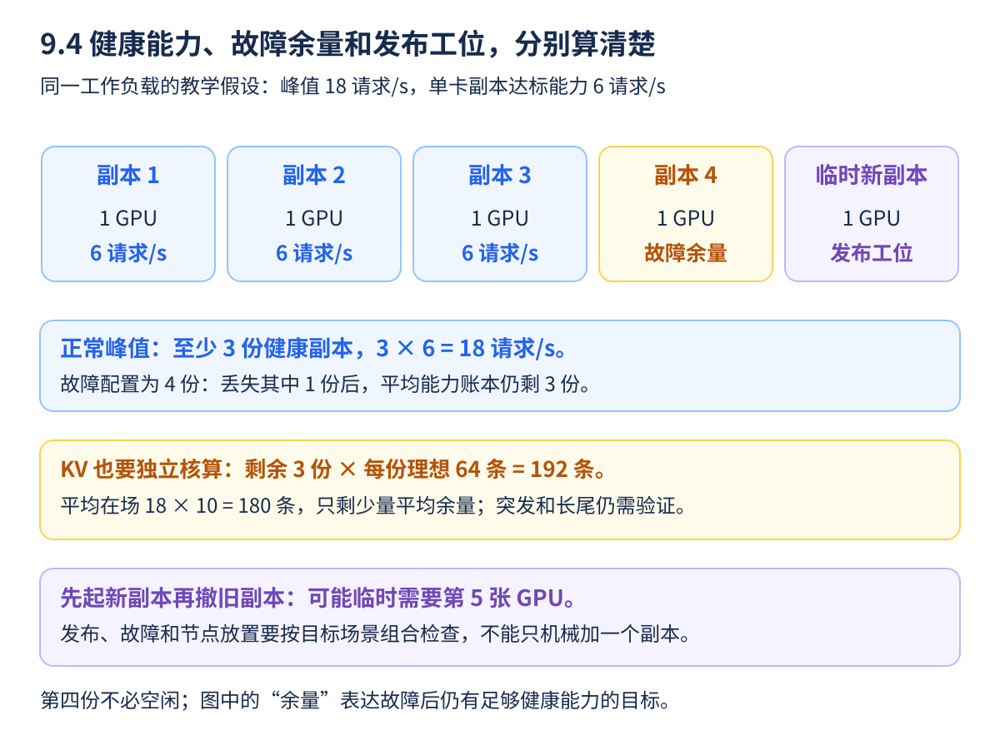

“模型能放进一张卡，所以准备一张卡就够了”忽略了很多问题：一秒会来多少人，每人问多长，要等多久，以及一张卡坏了以后怎么办。容量规划是在这些条件下计算服务规模，而不是按参数量直接查一张通用 GPU 数量表。

本节所有数字都是教学假设。真正的单副本能力来自第八章的固定工作负载压测，不能把这里的数字当成某个模型或设备的实测成绩。

<!-- more -->

## 📑 目录

- [1. 先写需求卡，再算卡数](#1-先写需求卡再算卡数)
  - [1.1 至少明确六个输入](#11-至少明确六个输入)
  - [1.2 峰值 QPS 不应该只是一秒截图](#12-峰值-qps-不应该只是一秒截图)
- [2. 单副本能力要在 SLO 下测出来](#2-单副本能力要在-slo-下测出来)
  - [2.1 不使用已经积压的峰值](#21-不使用已经积压的峰值)
  - [2.2 不要重复乘模糊的安全系数](#22-不要重复乘模糊的安全系数)
- [3. 第一本账：吞吐与健康副本数](#3-第一本账吞吐与健康副本数)
  - [3.1 先算正常接流量所需数量](#31-先算正常接流量所需数量)
  - [3.2 再把副本数换成 GPU 数](#32-再把副本数换成-gpu-数)
- [4. 第二本账：KV 和同时在场的请求](#4-第二本账kv-和同时在场的请求)
  - [4.1 平均在场数来自速率与停留时间](#41-平均在场数来自速率与停留时间)
  - [4.2 用同一单位估计缓存容量](#42-用同一单位估计缓存容量)
  - [4.3 抢占不是额外创造容量](#43-抢占不是额外创造容量)
- [5. 一个普通 CPU 可运行的规划练习](#5-一个普通-cpu-可运行的规划练习)
- [6. 第三本账：故障域、冷启动与发布余量](#6-第三本账故障域冷启动与发布余量)
  - [6.1 一份副本故障，与一台机器故障不同](#61-一份副本故障与一台机器故障不同)
  - [6.2 冷启动决定扩容救不救得及](#62-冷启动决定扩容救不救得及)
  - [6.3 发布会暂时多占资源](#63-发布会暂时多占资源)
- [7. 成本用 GPU 小时和合格工作量解释](#7-成本用-gpu-小时和合格工作量解释)
  - [7.1 先算资源，再引入实际价格](#71-先算资源再引入实际价格)
  - [7.2 多卡总产出更高，不等于更省](#72-多卡总产出更高不等于更省)
- [8. 把三本账合成一个验证循环](#8-把三本账合成一个验证循环)
- [总结](#-总结)
- [自我检验清单](#-自我检验清单)
- [参考资料](#-参考资料)

---

## 1. 先写需求卡，再算卡数

### 1.1 至少明确六个输入

| 输入 | 应写成什么 | 为什么重要 |
|------|------------|------------|
| 质量与模型 | 固定 revision、任务与允许精度 | 换模型可能改变答案和工作量 |
| 长度分布 | 短/长输入、输出与上下文 | 同 QPS 下资源消耗可能完全不同 |
| 服务目标 | 首字、出字、失败、联合通过率 | 只看峰值吞吐会接入过多请求 |
| 流量 | 常态、峰值、突发持续时间 | 平均值不能覆盖短时拥挤 |
| 副本形态 | 单卡、TP/PP、GPU 型号 | 一份副本未必只占一张卡 |
| 可用性 | 能容忍哪种故障与恢复时间 | 多副本不等于跨故障域 |

### 1.2 峰值 QPS 不应该只是一秒截图

需要区分短尖刺和持续高峰，以及是否存在请求重试、限流和批量任务。把被拒绝请求删掉，只看已成功的 QPS，会低估真实需求。

输入输出相关性也重要：长文分析可能同时长输入、长输出。只保存两个独立平均数，会丢失同一请求的共同压力，最好保留分桶和代表性回放。

## 2. 单副本能力要在 SLO 下测出来

### 2.1 不使用已经积压的峰值

设在指定模型、硬件、长度、缓存与质量条件下，一份副本可持续接住 $q_{\text{SLO}}$ 请求/s，同时达到所需联合通过率，队列不持续增长。这才是后续规划的输入。

如果某次达到 20 请求/s，但 Waiting 一直上涨、超时大量发生，20 不是可直接使用的合格容量。温启动、冷缓存与更长上下文也可能需要分别测量。

### 2.2 不要重复乘模糊的安全系数

假如 $q_{\text{SLO}}$ 已经是保守的达标工作点，再乘多个来源不明的 0.7，会让容量结论无法解释。应分别列出负载波动、故障、发布和恢复预算，而不是把所有未知混成一个“经验系数”。

有明确目标利用率的服务需求模型也可以作为起点，见 7.5；但不同模型的参数不能互相套用，更不能把离线 Token/s 直接改写为在线请求/s。

## 3. 第一本账：吞吐与健康副本数

### 3.1 先算正常接流量所需数量

假设峰值流量 $\lambda_{\text{peak}}=18$ 请求/s，单副本在目标条件下可承担 6 请求/s：

$$
n_{\text{healthy}}=\left\lceil\frac{\lambda_{\text{peak}}}{q_{\text{SLO}}}\right\rceil
=\left\lceil\frac{18}{6}\right\rceil=3
$$

这是正常接流量所需的三份健康副本。再假设希望失去一份后仍有三份，就需要至少四份配置资源；只满足这个平均吞吐条件，仍不保证故障瞬间所有请求不受影响。

这里的“额外一份”表示故障后仍保有足够能力，不要求它平时一定闲置。四份都接流量也可以，关键是丢掉任意一份后，剩余副本在目标工作负载下仍能承担流量；故障时正在执行的请求、重试和重新路由还需另外验收。

### 3.2 再把副本数换成 GPU 数

如果一份副本使用 $g$ 张 GPU：

$$
N_{\text{GPU}}=n_{\text{provisioned}}\,g
$$

本算例先取单卡副本，四份就是四卡。若另一配置每份 TP=2，必须重新测出对应单副本能力；只有在该配置的已测能力也满足假设时，才可用四份×两卡得到八卡，不能凭卡数翻倍就默认吞吐也翻倍。

## 4. 第二本账：KV 和同时在场的请求

### 4.1 平均在场数来自速率与停留时间

稳定条件下，Little 定律给出 $N=\lambda W$。如果统计的是持有活跃 KV 的请求，$W$ 也应使用持有 KV 的相应时长，不应把代理里的全部等待不加区分地算成 GPU 缓存占用。

假设每秒 18 条进入活跃阶段，平均持有 KV 10 秒，则平均约 180 条在场。这不是某一瞬间的固定并发，突发和长尾还会让峰值更高。

### 4.2 用同一单位估计缓存容量

再假设一个单卡模型结构为 32 层、8 个 KV Head、每 Head 宽度 128、每元素 2 字节，完整 KV 每 Token 为 128 KiB。这只是用于算账的结构，不是 9.1 小模型的配置。

假设运行预算 32 GiB 中，权重占 14 GiB，其他预留 2 GiB，剩余 KV 预算 16 GiB。忽略块取整等开销时：

| 每条保留的上下文 | 每条 KV 纯数据 | 每副本理想可容纳数 |
|------------------|----------------|--------------------|
| 2048 Token | 256 MiB | 64 |
| 8192 Token | 1 GiB | 16 |

四副本的理想合计分别为 256 与 64；面对平均 180 条活跃请求，后一种长度分布明显不能沿用前面的容量结论。**工作负载变了，单副本能力也要重测。**

共享前缀、混合缓存结构、TP 下 KV Head 复制与尾块取整都会改变实际预算。真实规划应使用引擎缓存容量与请求历史分布验证，表格不是显存可装入的保证。

### 4.3 抢占不是额外创造容量

引擎可能通过抢占、重算等方式维持运行，但用户会多等。仅看“没有 OOM”就认为并发足够，会漏掉性能损失。排队、抢占、缓存水位与 SLO 要放在同一份记录里。

## 5. 一个普通 CPU 可运行的规划练习

```python
from math import ceil

peak_rps = 18
measured_slo_rps = 6  # 教学假设，不是设备实测。
failure_budget = 1
healthy = ceil(peak_rps / measured_slo_rps)
provisioned = healthy + failure_budget
gpus_per_replica = 1

per_token_bytes = 2 * 32 * 8 * 128 * 2
kv_budget = 16 * 1024 ** 3
short_capacity = kv_budget // (2048 * per_token_bytes)
long_capacity = kv_budget // (8192 * per_token_bytes)
active_requests = ceil(peak_rps * 10)

print("健康/配置副本:", healthy, provisioned)
print("GPU:", provisioned * gpus_per_replica)
print("两种长度的每副本理想容量:", short_capacity, long_capacity)
assert (healthy, provisioned) == (3, 4)
assert (short_capacity, long_capacity) == (64, 16)
assert provisioned * short_capacity >= active_requests
assert provisioned * long_capacity < active_requests
```

先手算输出，再运行程序。程序仅检查假设下的数量关系，没有模拟组批、Token 生成、故障恢复或队列分布，不是自动求解真实最优配置的工具。

## 6. 第三本账：故障域、冷启动与发布余量

### 6.1 一份副本故障，与一台机器故障不同

四份副本都在同一节点，节点故障会同时丢失四份。若要求容忍最多两份同时失效，简化平均容量账本需要至少 $3+2=5$ 份，并且实际布局要保证单个目标故障域不会丢失更多。

还要考虑节点、可用区、存储和网关等共同依赖。Pod 反亲和或拓扑分布规则有助于表达放置意图，但需要足够设备与节点，规则本身不创造可用性。

### 6.2 冷启动决定扩容救不救得及

记录调度等待、镜像拉取、模型读取、加载、编译/预热、探针通过、流量接入各段耗时。只测 `vllm serve` 命令执行后的一小段，不代表整个可用副本的上线时间。

基础容量覆盖常见流量，扩容处理可预期增长，准入应对来不及扩展的突发。没有明确的队列上限与过载策略，再多的 maxReplicas 也可能晚于请求的首字期限。

### 6.3 发布会暂时多占资源

9.1 的先起新副本再撤旧副本，需要额外 GPU 和模型存储访问能力。四份正常配置并不自动包括发布时的第五份；如果要同时容忍故障与发布，需要按目标场景重新枚举预算。



**顺着图核对三次，而不是只数五个方框**：正常峰值先需要三份健康能力；为容忍单副本失效，配置数增到四；若采用图中先起新再撤旧的更新方式，还可能需要一个临时发布工位。这里每份假设用一张卡，换成多卡副本时，卡数与单副本能力都要重新计算。

再回到 KV 账本：如果每份理想容量为 64 条，失去一份后的三份合计是 192，略高于假设平均在场数 180；这只通过平均数量的必要检查，仍要看峰值、分布与实际块开销。如果换成长上下文，每份仅能放 16 条，即使四份都健康也只有 64，更不能因为吞吐公式得到四份就忽略显存压力。

**小练习**：把四份放在同一台机器上，可以宣称能容忍“一台机器故障”吗？不能，那个故障会同时带走四份。图表达单副本失效的预算，真实节点/可用区布局必须与目标故障域对应；发布和故障也不能只靠机械相加就保证任意组合都安全。

排空时间还受最长允许请求影响。设定合理上下文、输出和时长契约，才能安排退出预算，避免缩容时长期等不到结束或突然截断流式输出。

## 7. 成本用 GPU 小时和合格工作量解释

### 7.1 先算资源，再引入实际价格

四张卡持续运行 24 小时，是 96 GPU 小时；四份两卡副本则是 192 GPU 小时。计算货币成本还需使用实际合同或计费数据，并加入 CPU、内存、存储、网络和空闲余量，本文不假定当前价格。

单位合格请求成本可用相同时间窗内总成本除以达标请求数。长输出、失败和质量不合格要按已定义口径处理，不能拿总 Token 吞吐代替所有业务价值。

GPU 小时可以先当“工位出租了多久”理解。临时第五张卡若只在两小时发布窗口占用，会额外产生 2 GPU 小时，不应直接把整天写成五卡×24小时；同时，未分配给 Pod 的云实例是否仍收费，要看实际资源与计费边界。先记清分时占用，再引入真实价格，才方便解释账单。

### 7.2 多卡总产出更高，不等于更省

同时报告总 Goodput、单位 GPU Goodput、延迟、质量和可用性条件。更低空闲率可能降低余量，故障或突发时反而不达标；容量方案是在约束内权衡，不是单独最大化硬件忙碌程度。

## 8. 把三本账合成一个验证循环


计算、KV、网络、CPU 和存储都核对以后，再把纸面规模放到实际运行场景中检查：


持续观测发现长度、流量或命中率变化时，返回第一张图重新核对需求和单副本能力。这是一个循环，而不是第一次算完就永久有效的采购数字。

第一次完成容量报告，可以按正常峰值、长输入增长、长输出增长、一个故障域失效、滚动更新五种情形检查。每一项写出数据来源、假设与未验证条件。

上线后持续观察真实长度、命中率、队列、拒绝、失败和 Goodput。如果流量形态偏离实验，不应只重复旧公式；返回单副本测量和回放，更新可解释的容量模型。

## 📝 总结

- 先固定业务、质量与 SLO，再使用同工作负载下的单副本能力。
- 吞吐副本数、GPU 数与 KV 容量是不同约束。
- 故障域、冷启动和发布需要明确余量，不应藏进模糊系数。
- 成本最终应与合格工作量、可用性和实际计费边界一起解释。

## 🎯 自我检验清单

- 能解释为什么模型能装下不等于服务容量足够
- 能手算 18 请求/s、单副本 6 请求/s 与容忍一副本失效的规模
- 能区分 Little 定律里的系统等待与实际持有 KV 时长
- 能说明上下文从 2048 到 8192 后为什么不能沿用旧 QPS
- 能区分单副本故障和单节点故障的影响
- 能把滚动更新额外资源与常态规模分别列出
- 能计算 GPU 小时并说明它还遗漏哪些总成本

## 📚 参考资料

- [vLLM v0.19.0 — Parallelism and Scaling](https://github.com/vllm-project/vllm/blob/v0.19.0/docs/serving/parallelism_scaling.md)
- [vLLM v0.19.0 — Benchmark Serve](https://github.com/vllm-project/vllm/blob/v0.19.0/vllm/benchmarks/serve.py)
- [Kubernetes — Deployment 与滚动更新](https://kubernetes.io/docs/concepts/workloads/controllers/deployment/)
- [Kubernetes — Horizontal Pod Autoscaling](https://kubernetes.io/docs/concepts/workloads/autoscaling/horizontal-pod-autoscale/)

---

[返回本章](https://caomaolufei.github.io/AIInfraGuide/inference/模块四-推理优化/第9章-生产部署与运维/) · [上一节](https://caomaolufei.github.io/AIInfraGuide/inference/模块四-推理优化/第9章-生产部署与运维/93-自动扩缩容与负载均衡/) · [下一章](https://caomaolufei.github.io/AIInfraGuide/inference/模块四-推理优化/第10章-端侧推理/第10章-端侧推理/)
